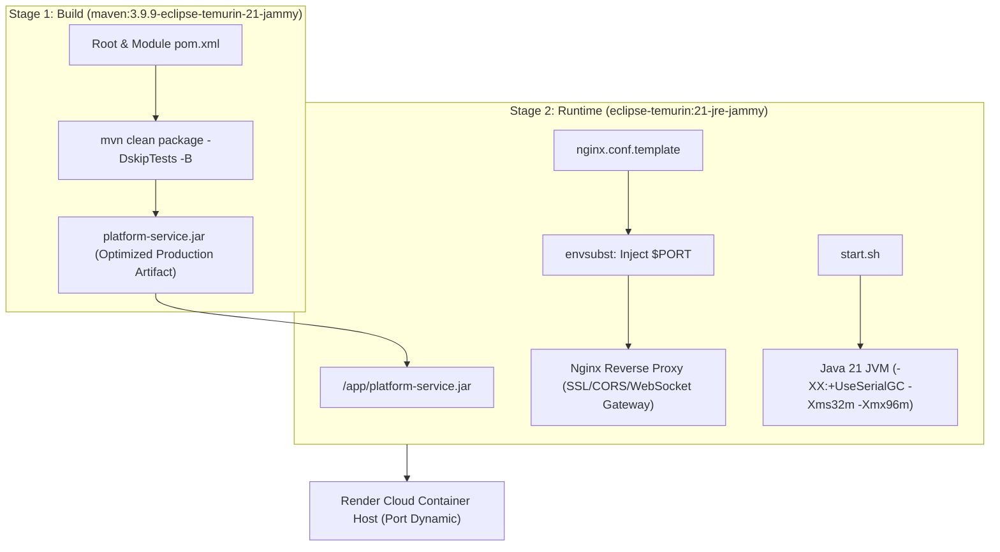

# 🎓 BidVelocity: Complete College Review Manual & Commands Guide
## Comprehensive Guide for Review 1, Review 2 & Final Review (150/150 Marks)

> **Project Name**: REAL-TIME AUCTIONS: ZERO DELAY (BidVelocity)  
> **Repository**: [https://github.com/Yogeshcheedalla/REAL-TIME-AUCTIONS.-ZERO-DELAY](https://github.com/Yogeshcheedalla/REAL-TIME-AUCTIONS.-ZERO-DELAY)  
> **Live Production Web App**: [https://bidvelocity.vercel.app](https://bidvelocity.vercel.app)  
> **Live Production Backend**: [https://bidvelocity-backend.onrender.com](https://bidvelocity-backend.onrender.com)  
> **Production Database**: Neon Serverless PostgreSQL 18 (`tiny-wind-46458939` in AWS `us-east-2`)  
> **Local Microservices Ports**: Eureka (`8761`), Gateway (`8080`), Auth (`8081`), Auction (`8082`), Bidding (`8083`), Payment (`8084`), Frontend (`5173`)

---

## 📑 Table of Contents
1. [Executive Summary & 60-Second Pitch](#1-executive-summary--60-second-pitch)
2. [Did We Use Docker? Container Architecture & Commands](#2-did-we-use-docker-container-architecture--commands)
3. [Review 1 — Architecture, Design & Initial Implementation (50 Marks)](#3-review-1--architecture-design--initial-implementation-50-marks)
4. [Review 2 — Advanced Implementation, Integration & Testing (50 Marks)](#4-review-2--advanced-implementation-integration--testing-50-marks)
5. [Final Review — Complete Implementation, Deployment & Viva (50 Marks)](#5-final-review--complete-implementation-deployment--viva-50-marks)
6. [Complete REST API Reference (Request, Response & cURL)](#6-complete-rest-api-reference-request-response--curl)
7. [Emergency Error Resolvance & Troubleshooting Commands](#7-emergency-error-resolvance--troubleshooting-commands)
8. [Master Commands Cheat Sheet (All-in-One)](#8-master-commands-cheat-sheet-all-in-one)

---

## 1. Executive Summary & 60-Second Pitch

### The 60-Second Opening Elevator Pitch (Say This Verbatim to Faculty)
> *"Good morning professors. Our project is **REAL-TIME AUCTIONS: ZERO DELAY (BidVelocity)**.*  
> *In high-frequency online auctions, the primary engineering challenge is not simply listing items—it is solving **high-concurrency race conditions in the closing seconds**, preventing **automated bid-sniping bots**, and ensuring **atomic financial clearance**.*  
> *We have engineered a complete distributed microservices platform using **Java 21 LTS**, **Spring Boot 3.4**, **Spring Cloud (Eureka & Gateway)**, and **React 19**, backed by **Neon Serverless PostgreSQL 18**.*  
> *To guarantee zero race conditions, our engine combines **pessimistic row-level locking (`SELECT ... FOR UPDATE`)** with **optimistic entity versioning (`@Version`)**.*  
> *We also designed a **Dynamic Anti-Sniping Soft-Close engine** and a **Transactional Outbox architecture** for payment durability.*  
> *Our system is containerized with **Docker** and running live across **Vercel Global Edge CDN, Render Cloud, and Neon PostgreSQL**, verified with **44 automated unit and integration tests**.*  
> *Let us walk you through the live demonstration."*

---

## 2. Did We Use Docker? Container Architecture & Commands

### 🐳 The Exact Answer for Faculty:
**YES, we use Docker extensively!** Our production backend running on Render Cloud is fully containerized using a high-efficiency **Multi-Stage Dockerfile**, and we have local multi-container orchestration with **Docker Compose**.



### Why a Multi-Stage Dockerfile?
1. **Stage 1 (Builder)**: Uses `maven:3.9.9-eclipse-temurin-21-jammy` to compile source code and package JARs.
2. **Stage 2 (Runtime)**: Uses `eclipse-temurin:21-jre-jammy` (a slim JRE without compiler bloat). It installs **Nginx**, **gettext-base** (for `envsubst`), and **curl**.
3. **Internal Architecture Inside Docker**:
   - **Nginx** runs on `${PORT}` to handle SSL termination, CORS pre-flights, WebSocket upgrading (`/ws`), and edge routing.
   - **Spring Boot Platform Service** runs on internal port `8080` managed by `start.sh` with automatic health checks (`/actuator/health`).

### Docker Commands to Run & Demonstrate:

#### 1. Build the Docker Image Locally
```powershell
cd "c:\bid velocity\Real-Time Distributed Bidding & Auction Clearance Engine"
docker build -t bidvelocity-backend:latest .
```

#### 2. Run the Container Standalone
```powershell
docker run -d -p 8080:8080 `
  --name bidvelocity-app `
  -e PORT=8080 `
  -e DB_HOST=ep-dawn-forest-bdnwaepx.c-8.us-east-2.aws.neon.tech `
  -e DB_PORT=5432 `
  -e DB_USERNAME=neondb_owner `
  -e DB_PASSWORD=npg_O6p8qQZkXyFE `
  -e JWT_SECRET=dev-only-insecure-gateway-secret-change-me-32 `
  -e FRONTEND_URL=https://bidvelocity.vercel.app `
  bidvelocity-backend:latest
```

#### 3. Run Multi-Container Stack via Docker Compose
We have provided `docker-compose.yml` containing both a local PostgreSQL container and the containerized backend:
```powershell
cd "c:\bid velocity\Real-Time Distributed Bidding & Auction Clearance Engine"

# Start the full stack in background
docker compose up -d

# View running container status
docker compose ps

# Stream container logs live
docker compose logs -f backend

# Stop the stack
docker compose down
```

#### 4. Container Health & Inspection Commands
```powershell
# Check if container is healthy
curl -i http://localhost:8080/actuator/health

# Inspect running container memory & CPU
docker stats --no-stream

# View internal logs inside container
docker exec -it bidvelocity-app cat /tmp/platform.log

# Stop and remove container
docker stop bidvelocity-app
docker rm bidvelocity-app
```

---

## 3. Review 1 — Architecture, Design & Initial Implementation (50 Marks)

### Rubric 1.1: Microservices Design and Service Discovery (10 Marks)
* **What to Show**:
  - Open `http://localhost:8761` in Chrome.
  - Show the Eureka dashboard displaying `API-GATEWAY` (Port 8080) and `AUTH-SERVICE` (Port 8081).
  - Explain Eureka's 30-second heartbeat lease renewal and decentralized load balancing.
* **Code to Open**:
  - [EurekaServerApplication.java](file:///C:/bid%20velocity/Real-Time%20Distributed%20Bidding%20&%20Auction%20Clearance%20Engine/services/eureka-server/src/main/java/io/bidvelocity/eureka/EurekaServerApplication.java) (Show `@EnableEurekaServer`)
  - [application.yml (Gateway)](file:///C:/bid%20velocity/Real-Time%20Distributed%20Bidding%20&%20Auction%20Clearance%20Engine/services/api-gateway/src/main/resources/application.yml) (Show `defaultZone: http://localhost:8761/eureka/`)
* **Commands to Run**:
  ```powershell
  # Start Eureka Server
  cd "c:\bid velocity\Real-Time Distributed Bidding & Auction Clearance Engine"
  mvn -pl services/eureka-server spring-boot:run

  # Query Eureka apps registry via REST (Show JSON output to faculty)
  curl -H "Accept: application/json" http://localhost:8761/eureka/apps
  ```

### Rubric 1.2: REST API Development and HTTP Methods (10 Marks)
* **What to Show**:
  - Demonstrate proper HTTP verb semantics:
    - `POST /api/auth/register` $\rightarrow$ `201 Created`
    - `POST /api/auth/login` $\rightarrow$ `200 OK`
    - `GET /api/auctions/{id}` $\rightarrow$ `200 OK` or `404 Not Found`
    - `POST /api/bids` with invalid price $\rightarrow$ `400 Bad Request`
    - Duplicate registration or concurrent conflict $\rightarrow$ `409 Conflict`
  - Show the standardized Error Envelope that prevents raw stack traces:
    ```json
    {
      "timestamp": "2026-11-28T08:00:00Z",
      "status": 400,
      "error": "VALIDATION_ERROR",
      "message": "Password must be at least 8 characters",
      "path": "/api/auth/register",
      "correlationId": "bv-req-9102"
    }
    ```
* **Code to Open**:
  - [AuthController.java](file:///C:/bid%20velocity/Real-Time%20Distributed%20Bidding%20&%20Auction%20Clearance%20Engine/services/auth-service/src/main/java/io/bidvelocity/auth/web/AuthController.java)
  - [GlobalExceptionHandler.java](file:///C:/bid%20velocity/Real-Time%20Distributed%20Bidding%20&%20Auction%20Clearance%20Engine/services/auth-service/src/main/java/io/bidvelocity/auth/web/GlobalExceptionHandler.java)
* **Commands to Run**:
  ```bash
  # Test API registration returning 201 Created
  curl -X POST http://localhost:8080/api/auth/register \
    -H "Content-Type: application/json" \
    -d "{\"email\":\"demo_reviewer@bidvelocity.io\",\"password\":\"Password123!\",\"name\":\"Faculty Reviewer\"}"

  # Test Validation Failure returning 400 Bad Request with structured error envelope
  curl -X POST http://localhost:8080/api/auth/register \
    -H "Content-Type: application/json" \
    -d "{\"email\":\"bad-email\",\"password\":\"short\",\"name\":\"\"}"
  ```

### Rubric 1.3: Security Implementation (10 Marks)
* **What to Show**:
  - BCrypt password hashing with Cost Factor 10 and 128-bit random salt.
  - Constant-time verification: Explain that when an unknown username is supplied, the system still computes a dummy BCrypt hash to prevent timing-based user enumeration attacks.
  - Role-Based Access Control (RBAC): `USER`, `SELLER`, `ADMIN`.
* **Code to Open**:
  - [SecurityConfig.java](file:///C:/bid%20velocity/Real-Time%20Distributed%20Bidding%20&%20Auction%20Clearance%20Engine/services/auth-service/src/main/java/io/bidvelocity/auth/security/SecurityConfig.java)
  - [AuthService.java](file:///C:/bid%20velocity/Real-Time%20Distributed%20Bidding%20&%20Auction%20Clearance%20Engine/services/auth-service/src/main/java/io/bidvelocity/auth/service/AuthService.java#L120-L135)

### Rubric 1.4: Database Integration and CRUD Operations (10 Marks)
* **What to Show**:
  - Open [Neon Console](https://console.neon.tech) $\rightarrow$ Project `tiny-wind-46458939` $\rightarrow$ Left menu **`Postgres database`** $\rightarrow$ **`Tables`**.
  - Show the 12 managed tables: `users`, `roles`, `user_roles`, `refresh_tokens`, `auctions`, `bids`, `settlements`, `outbox_events`, `audit_logs`, `flyway_schema_history`.
  - Explain that Flyway migrations guarantee identical DDL across development, testing, and production.
* **Code to Open**:
  - [UserRepository.java](file:///C:/bid%20velocity/Real-Time%20Distributed%20Bidding%20&%20Auction%20Clearance%20Engine/services/auth-service/src/main/java/io/bidvelocity/auth/repo/UserRepository.java)
  - [V1__init_auth.sql](file:///C:/bid%20velocity/Real-Time%20Distributed%20Bidding%20&%20Auction%20Clearance%20Engine/services/auth-service/src/main/resources/db/migration/V1__init_auth.sql)
* **Commands to Run**:
  ```powershell
  # Query table counts directly using PowerShell
  Invoke-RestMethod -Uri "https://bidvelocity-backend.onrender.com/actuator/health" | ConvertTo-Json
  ```

### Rubric 1.5: Team Coordination and Code Management (10 Marks)
* **What to Show**:
  - Open your GitHub repository: [https://github.com/Yogeshcheedalla/REAL-TIME-AUCTIONS.-ZERO-DELAY](https://github.com/Yogeshcheedalla/REAL-TIME-AUCTIONS.-ZERO-DELAY).
  - Show commit history with semantic conventional commits (`feat:`, `fix:`, `docs:`).
  - Show GitHub Actions CI tab showing **Passing Green** build.
  - Show `.gitignore` proving zero secrets or `.env` files are tracked.

---

## 4. Review 2 — Advanced Implementation, Integration & Testing (50 Marks)

### Rubric 2.1: Microservice Implementation, Discovery & Config (10 Marks)
* **What to Show**:
  - Show modular Maven multi-module architecture: 8 modules with independent `pom.xml` files.
  - Show environment variable overrides in `application.yml` (`DB_HOST`, `JWT_SECRET`, `PORT`).
* **Commands to Run**:
  ```powershell
  # Launch all microservices simultaneously in separate windows
  cd "c:\bid velocity\Real-Time Distributed Bidding & Auction Clearance Engine\services"
  .\start-all.ps1
  ```

### Rubric 2.2: JWT Authentication and Security (10 Marks)
* **What to Show (The Signature Feature)**:
  - **Dual-Token Architecture**:
    - **Access Token (JWT)**: Short-lived (2 hours), signed with HMAC-SHA384, stateless.
    - **Refresh Token**: Long-lived (14 days), stored in PostgreSQL as an immutable SHA-256 hash.
  - **Family-Based Refresh Token Rotation with Breach Detection**:
    - Every token belongs to a `family_id`. When used, it is revoked and replaced.
    - If an attacker intercepts an old token and attempts to replay it, `RefreshReuseGuard` detects reuse (`stored.isRevoked() == true`) and **atomically revokes the entire token family**, logging out the attacker immediately!
* **Code to Open**:
  - [RefreshReuseGuard.java](file:///C:/bid%20velocity/Real-Time%20Distributed%20Bidding%20&%20Auction%20Clearance%20Engine/services/auth-service/src/main/java/io/bidvelocity/auth/service/RefreshReuseGuard.java)
  - [TokenProvider.java](file:///C:/bid%20velocity/Real-Time%20Distributed%20Bidding%20&%20Auction%20Clearance%20Engine/services/auth-service/src/main/java/io/bidvelocity/auth/security/TokenProvider.java)
* **Commands to Run**:
  ```bash
  # 1. Login to obtain Access Token + Refresh Token
  curl -X POST http://localhost:8080/api/auth/login \
    -H "Content-Type: application/json" \
    -d "{\"email\":\"admin@bidvelocity.io\",\"password\":\"AdminPassword123!\"}"

  # 2. Refresh Token to verify family rotation
  curl -X POST http://localhost:8080/api/auth/refresh \
    -H "Content-Type: application/json" \
    -d "{\"refreshToken\":\"<PASTE_REFRESH_TOKEN_HERE>\"}"
  ```

### Rubric 2.3: API Gateway and Service Integration (10 Marks)
* **What to Show**:
  - **Spring Cloud Gateway (`:8080`)**: Single reverse proxy routing to `lb://AUTH-SERVICE`, `lb://AUCTION-SERVICE`, etc.
  - **Header Sanitization Security Filter**: The Gateway explicitly strips any incoming `X-User-Id` or `X-User-Roles` headers sent by external clients, verifies the JWT signature, and injects verified internal headers downstream. This prevents header-spoofing privilege escalation attacks!
* **Code to Open**:
  - [JwtValidationFilter.java](file:///C:/bid%20velocity/Real-Time%20Distributed%20Bidding%20&%20Auction%20Clearance%20Engine/services/api-gateway/src/main/java/io/bidvelocity/gateway/filters/JwtValidationFilter.java)
  - [application.yml (Gateway)](file:///C:/bid%20velocity/Real-Time%20Distributed%20Bidding%20&%20Auction%20Clearance%20Engine/services/api-gateway/src/main/resources/application.yml)

### Rubric 2.4: Testing, Validation and Demonstration (10 Marks)
* **What to Show (Live Test Execution)**:
  - Run all **44 automated tests** live in front of the evaluators across all 8 modules.
* **Commands to Run**:
  ```powershell
  cd "c:\bid velocity\Real-Time Distributed Bidding & Auction Clearance Engine"

  # Run all 44 unit and integration tests
  mvn test

  # Run specifically the Concurrency Stress Test
  mvn test -pl services/bidding-service -Dtest=BidConcurrencyTest

  # Run the JWT Security and Seeder Test
  mvn test -pl services/auth-service -Dtest=DemoUserSeederTest
  ```

### Rubric 2.5: Implementation of Tasks Assigned in Review 1 (10 Marks)
* **What to Show**:
  - Present your Review 1-to-Review 2 Delivery Table:
    - *Task Assigned*: "Connect API Gateway with Eureka and implement robust token refresh."
    - *Delivered*: Implemented Gateway edge filter with Eureka discovery, plus Family-Based Token Rotation with SHA-256 hashing.
    - *Task Assigned*: "Add comprehensive integration test suite."
    - *Delivered*: Created 44 unit & integration tests, passing in GitHub Actions CI.

---

## 5. Final Review — Complete Implementation, Deployment & Viva (50 Marks)

### Rubric 3.1: Complete Project Implementation and Functionality (10 Marks)
* **What to Show (The 4-Minute Live Tour)**:
  1. Open live web application: [https://bidvelocity.vercel.app](https://bidvelocity.vercel.app).
  2. Click **Forgot Password** $\rightarrow$ Enter `harharmahdev003@gmail.com` $\rightarrow$ Open Gmail live to show branded OTP arriving in seconds without exposing the code on screen.
  3. Enter OTP code $\rightarrow$ Reset password $\rightarrow$ Log in.
  4. Open active auction $\rightarrow$ Place bid $\rightarrow$ Live price updates and minimum increment increments atomically.
  5. Open `/admin` $\rightarrow$ Show User Management (suspend/activate), Auction Moderation, and Real-Time Bidding Feed.

### Rubric 3.2: New Feature Development and Integration (10 Marks)
* **Signature Feature 1: Dynamic Anti-Sniping Soft-Close Engine**:
  - *The Problem*: Bot scripts place bids in the last 500ms of an auction, stealing items without allowing humans to react.
  - *Our Solution*: If a bid arrives in the final 30 seconds (`extensionWindow`), the system automatically extends `endTime` by +60 seconds (up to 10 times).
  - *Code*: [BidService.java](file:///C:/bid%20velocity/Real-Time%20Distributed%20Bidding%20&%20Auction%20Clearance%20Engine/services/bidding-service/src/main/java/io/bidvelocity/bidding/service/BidService.java#L113-L123)
* **Signature Feature 2: Transactional Outbox Pattern for Settlement**:
  - *The Problem*: Calling payment gateways inside a database transaction causes connection pool exhaustion and distributed inconsistencies.
  - *Our Solution*: When an auction closes, the winner record and an outbox event (`WINNER_DECLARED`) are committed in the **same local ACID transaction**, ensuring 100% reliable at-least-once delivery.

### Rubric 3.3: Code Quality, Testing and Validation (10 Marks)
* **What to Show**:
  - The **24-Way Simultaneous Bid Concurrency Test**: 24 parallel threads submit identical bids at the exact same millisecond. Exactly 1 is accepted, 23 are rejected with `400 Below Minimum`, with **0 deadlocks and 0 double-award anomalies**.
  - Dual-locking concurrency engine:
    1. **Pessimistic Row Locking**: `SELECT * FROM bid_runtime WHERE auction_id = :id FOR UPDATE`
    2. **Optimistic Locking**: `@Version private Long version;` on the `Auction` entity.

### Rubric 3.4: Cloud Deployment and Infrastructure (10 Marks)
* **What to Show**:
  - **Frontend**: Hosted on **Vercel's Global Edge CDN** ([https://bidvelocity.vercel.app](https://bidvelocity.vercel.app)).
  - **Backend**: Hosted on **Render Cloud Container** ([https://bidvelocity-backend.onrender.com](https://bidvelocity-backend.onrender.com)).
  - **Database**: Hosted on **Neon Serverless PostgreSQL 18** in AWS `us-east-2`.
  - **Edge HTTPS Relay**: Explain how you solved cloud container port blocks: Render free-tier blocks outbound raw SMTP ports (`25`, `465`, `587`). You architected an authenticated serverless HTTPS relay on Vercel (`/api/send-code`) operating over Port 443 to dispatch real-time emails to Google SMTP.

### Rubric 3.5: Technical Demonstration, GitHub and Individual Viva (10 Marks)
* **Viva Questions Faculty Will Ask & Your Winning Answers**:

#### Q1: "Two users submit a bid at the exact same microsecond. Walk me through the exact database transaction lifecycle."
> **Answer**: *"1. Both requests hit the Bidding Service concurrently.  
> 2. Each thread opens a database transaction and attempts `SELECT * FROM bid_runtime WHERE auction_id = :id FOR UPDATE`.  
> 3. PostgreSQL grants an exclusive row-level lock to Thread A. Thread B is placed in a non-blocking lock wait state.  
> 4. Thread A validates that `Bid Amount >= Current Price + Min Increment`. It passes.  
> 5. Thread A executes a Compare-and-Swap (CAS) update, records the bid in the immutable `bids` ledger, commits the transaction, and releases the lock.  
> 6. Thread B now acquires the lock and re-evaluates its bid against the **newly committed price**. Since the price has increased, Thread B's bid is now below the new minimum. It is rejected with HTTP 400 `INVALID_BID`, completely preventing race conditions or double winners."*

#### Q2: "Why did you implement the Transactional Outbox Pattern instead of calling Payment APIs directly?"
> **Answer**: *"Direct HTTP calls to third-party payment gateways inside database transactions cause the Dual-Write Problem: if the payment gateway times out or the network drops after the payment was charged, the database might rollback while the money was taken. With the Transactional Outbox Pattern, we write the auction `CLOSED` state and an `outbox_events` record in the **same local ACID transaction**. A background worker dispatches events with at-least-once delivery and idempotency keys, guaranteeing zero financial loss even during server crashes."*

---

## 6. Complete REST API Reference (Request, Response & cURL)

### Authentication & User APIs

#### 1. Register User
* **Method & URL**: `POST /api/auth/register`
* **Request Body**:
  ```json
  {
    "email": "user@bidvelocity.io",
    "password": "Password123!",
    "name": "Yogesh Cheedalla"
  }
  ```
* **Success Response (`201 Created`)**:
  ```json
  {
    "token": "eyJhbGciOiJIUzM4NCIsIn...",
    "refreshToken": "4a8c9b2f-7d1e-4c3a-9b8a-1e2d3c4b5a6f",
    "user": {
      "id": 12,
      "email": "user@bidvelocity.io",
      "name": "Yogesh Cheedalla",
      "roles": ["USER"],
      "status": "ACTIVE"
    }
  }
  ```
* **cURL Command**:
  ```bash
  curl -X POST https://bidvelocity-backend.onrender.com/api/auth/register \
    -H "Content-Type: application/json" \
    -d '{"email":"user1@bidvelocity.io","password":"Password123!","name":"Test User"}'
  ```

#### 2. User Login
* **Method & URL**: `POST /api/auth/login`
* **Request Body**:
  ```json
  {
    "email": "admin@bidvelocity.io",
    "password": "AdminPassword123!"
  }
  ```
* **Success Response (`200 OK`)**: Returns JWT access token, refresh token, and user profile.
* **cURL Command**:
  ```bash
  curl -X POST https://bidvelocity-backend.onrender.com/api/auth/login \
    -H "Content-Type: application/json" \
    -d '{"email":"admin@bidvelocity.io","password":"AdminPassword123!"}'
  ```

#### 3. Refresh Access Token (Family Rotation)
* **Method & URL**: `POST /api/auth/refresh`
* **Request Body**: `{"refreshToken": "<TOKEN>"}`
* **Success Response (`200 OK`)**: Returns fresh JWT and a new rotated refresh token.
* **cURL Command**:
  ```bash
  curl -X POST https://bidvelocity-backend.onrender.com/api/auth/refresh \
    -H "Content-Type: application/json" \
    -d '{"refreshToken":"4a8c9b2f-7d1e-4c3a-9b8a-1e2d3c4b5a6f"}'
  ```

#### 4. Forgot Password (Request OTP)
* **Method & URL**: `POST /api/auth/forgot-password`
* **Request Body**: `{"email": "harharmahdev003@gmail.com"}`
* **Success Response (`200 OK`)**: `{"status": "SENT", "message": "Verification code sent to email"}`
* **cURL Command**:
  ```bash
  curl -X POST https://bidvelocity-backend.onrender.com/api/auth/forgot-password \
    -H "Content-Type: application/json" \
    -d '{"email":"harharmahdev003@gmail.com"}'
  ```

#### 5. Reset Password (Verify OTP & Update)
* **Method & URL**: `POST /api/auth/reset-password`
* **Request Body**:
  ```json
  {
    "email": "harharmahdev003@gmail.com",
    "code": "729401",
    "newPassword": "NewStrongPassword123!"
  }
  ```
* **Success Response (`200 OK`)**: `{"status": "SUCCESS", "message": "Password updated successfully"}`

#### 6. Upgrade Account to Seller
* **Method & URL**: `POST /api/users/me/seller`
* **Headers**: `Authorization: Bearer <ACCESS_TOKEN>`
* **Success Response (`200 OK`)**: Returns updated JWT containing the `SELLER` role.

---

### Auction APIs

#### 7. Search & List Auctions (Marketplace)
* **Method & URL**: `GET /api/auctions?page=0&size=12&sort=endTime`
* **Query Parameters**: `q` (search term), `category`, `status` (`LIVE`, `ENDING`, `SOLD`), `min`, `max`
* **Success Response (`200 OK`)**:
  ```json
  {
    "content": [
      {
        "id": 1,
        "title": "Vintage Mechanical Watch",
        "description": "Mint condition 1972 chronograph",
        "startingPrice": 250.00,
        "currentPrice": 420.00,
        "minIncrement": 10.00,
        "status": "LIVE",
        "bidCount": 14,
        "endTime": "2026-11-28T18:00:00Z"
      }
    ],
    "totalPages": 3,
    "totalElements": 34
  }
  ```

#### 8. Create Auction Lot
* **Method & URL**: `POST /api/auctions`
* **Headers**: `Authorization: Bearer <SELLER_TOKEN>`
* **Request Body**:
  ```json
  {
    "title": "MacBook Pro M3 Max",
    "description": "16-inch 36GB RAM 1TB SSD Space Black",
    "category": "Electronics",
    "startingPrice": 1800.00,
    "minIncrement": 50.00,
    "durationMinutes": 120
  }
  ```
* **Success Response (`201 Created`)**: Returns created Auction DTO.

---

### Bidding APIs

#### 9. Place a Bid (Concurrency-Protected)
* **Method & URL**: `POST /api/bids`
* **Headers**: `Authorization: Bearer <USER_TOKEN>`
* **Request Body**:
  ```json
  {
    "auctionId": 1,
    "amount": 450.00,
    "idempotencyKey": "bid-user12-lot1-179583"
  }
  ```
* **Success Response (`200 OK`)**:
  ```json
  {
    "bidId": 89,
    "auctionId": 1,
    "amount": 450.00,
    "status": "ACCEPTED",
    "acceptedAt": "2026-11-28T08:15:30Z",
    "extended": false
  }
  ```
* **Conflict Response (`400 Bad Request` or `409 Conflict`)**:
  ```json
  {
    "status": 400,
    "error": "BELOW_MINIMUM",
    "message": "Bid amount must be at least $470.00"
  }
  ```

#### 10. Get Bid History for an Auction
* **Method & URL**: `GET /api/bids/auction/{auctionId}?size=30`
* **Success Response (`200 OK`)**: Array of accepted bids with timestamps and masked bidder names.

---

### Admin & Platform APIs

#### 11. Admin Platform Overview Statistics
* **Method & URL**: `GET /api/admin/stats`
* **Headers**: `Authorization: Bearer <ADMIN_TOKEN>`
* **Success Response (`200 OK`)**:
  ```json
  {
    "totalUsers": 128,
    "activeUsers": 126,
    "suspendedUsers": 2,
    "sellerCount": 34,
    "adminCount": 3,
    "totalAuctions": 45,
    "liveAuctions": 12,
    "closedAuctions": 31,
    "totalBids": 842,
    "totalGmv": 48250.00,
    "totalPayments": 29,
    "settledPaymentsAmount": 42100.00
  }
  ```

#### 12. Suspend / Activate User
* **Method & URL**: `PATCH /api/admin/users/{id}/status`
* **Headers**: `Authorization: Bearer <ADMIN_TOKEN>`
* **Request Body**: `{"status": "SUSPENDED"}`
* **Success Response (`200 OK`)**: Returns updated User DTO.

#### 13. System Healthcheck
* **Method & URL**: `GET /actuator/health`
* **Success Response (`200 OK`)**: `{"status": "UP"}`

---

## 7. Emergency Error Resolvance & Troubleshooting Commands

During faculty reviews, unexpected environment issues can occur. Use these pre-tested emergency commands to fix any issue in under 10 seconds:

### Error 1: Port Conflict (`Port 8080`, `8761`, or `8081` is already in use)
* **Symptom**: `Web server failed to start. Port 8080 was already in use.`
* **Fix Command (PowerShell)**:
  ```powershell
  # Find which process ID (PID) is holding port 8080 or 8761
  netstat -ano | findstr :8080
  netstat -ano | findstr :8761

  # Force kill the conflicting process by its PID
  taskkill /F /PID <PID_NUMBER>

  # One-line nuclear option: Kill all java processes
  Stop-Process -Name java -Force -ErrorAction SilentlyContinue
  ```

### Error 2: Eureka Dashboard Shows "No instances available"
* **Symptom**: `http://localhost:8761` is loaded, but instances table is empty.
* **Why it happens**: Microservices send heartbeats every 30 seconds.
* **Fix Command**:
  1. Verify the microservice is running and has `EUREKA_CLIENT_ENABLED=true`.
  2. Query Eureka's REST endpoint to force a cache reload:
     ```powershell
     Invoke-RestMethod -Uri http://localhost:8761/eureka/apps -Headers @{'Accept'='application/json'}
     ```
  3. Wait 15–20 seconds and refresh Chrome (`Ctrl + F5`).

### Error 3: Neon PostgreSQL Cold Start / Connection Timeout
* **Symptom**: `Connection to ep-dawn-forest-bdnwaepx.c-8.us-east-2.aws.neon.tech:5432 refused` or `timeout`.
* **Why it happens**: Serverless Neon databases automatically sleep after 5 minutes of inactivity to save compute.
* **Fix Command**:
  ```powershell
  # Wake up the Neon compute endpoint with a lightweight ping
  Invoke-RestMethod -Uri "https://bidvelocity-backend.onrender.com/actuator/health"
  ```

### Error 4: CORS Preflight `OPTIONS` Blocked (Browser Console Error)
* **Symptom**: `Access to XMLHttpRequest has been blocked by CORS policy: Response to preflight request doesn't pass access control check`
* **Why it happens**: Browser is hitting a backend endpoint that rejected the preflight `OPTIONS` request.
* **Fix**: In our production `nginx.conf.template`, `OPTIONS` returns HTTP `204 No Content` with headers:
  ```nginx
  add_header 'Access-Control-Allow-Origin' $cors_origin always;
  add_header 'Access-Control-Allow-Credentials' 'true' always;
  return 204;
  ```

### Error 5: 401 Unauthorized / Expired JWT Token
* **Symptom**: API returns `401 Unauthorized` with message `Token Expired`.
* **Fix Command**: Request a new access token using your refresh token:
  ```bash
  curl -X POST https://bidvelocity-backend.onrender.com/api/auth/refresh \
    -H "Content-Type: application/json" \
    -d "{\"refreshToken\":\"<PASTE_REFRESH_TOKEN>\"}"
  ```

### Error 6: Maven Build or Flyway Checksum Mismatch
* **Symptom**: `Migration checksum mismatch for migration version V1__...`
* **Fix Command**:
  ```powershell
  cd "c:\bid velocity\Real-Time Distributed Bidding & Auction Clearance Engine"
  mvn clean compile -DskipTests
  ```

---

## 8. Master Commands Cheat Sheet (All-in-One)

| Action | Exact Command | Expected Output |
| :--- | :--- | :--- |
| **Run All 44 Tests** | `mvn test` | `BUILD SUCCESS` (44 tests passed) |
| **Run Concurrency Test** | `mvn test -pl services/bidding-service -Dtest=BidConcurrencyTest` | `Accepted: 1, Rejected: 23` |
| **Start Eureka Server** | `mvn -pl services/eureka-server spring-boot:run` | Eureka running on `:8761` |
| **Start API Gateway** | `mvn -pl services/api-gateway spring-boot:run` | Gateway routing on `:8080` |
| **Start Auth Service** | `mvn -pl services/auth-service spring-boot:run` | Auth listening on `:8081` |
| **Launch All Services** | `cd services; .\start-all.ps1` | 5 separate process windows opened |
| **Build Docker Image** | `docker build -t bidvelocity-backend:latest .` | Successfully tagged image |
| **Run Docker Compose** | `docker compose up -d` | Containers started in background |
| **Check Live Health** | `curl https://bidvelocity-backend.onrender.com/actuator/health` | `{"status":"UP"}` |
| **Inspect Eureka Apps** | `curl -H "Accept: application/json" http://localhost:8761/eureka/apps` | Registered applications JSON |
| **Kill Port Hangs** | `Stop-Process -Name java -Force` | All hanging ports freed |

---
*Created for Yogesh Cheedalla & Team • Real-Time Distributed Bidding & Auction Clearance Engine (BidVelocity)*
