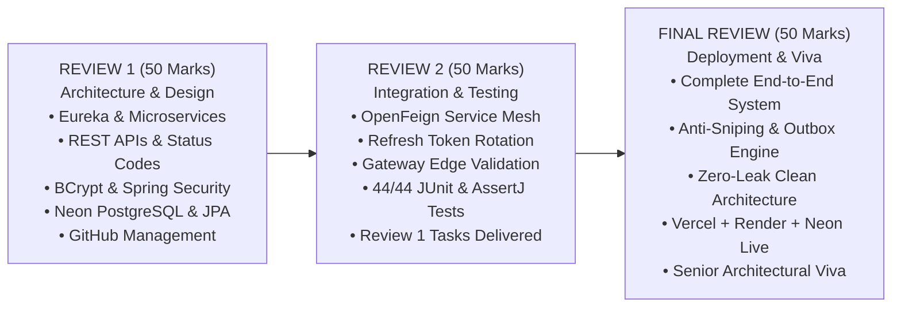

# 🎓 BidVelocity: College Evaluation Master Guide (Reviews 1, 2 & Final)
## Complete Rubric-by-Rubric Roadmap for 150/150 Maximum Marks

> **Project Name**: REAL-TIME AUCTIONS: ZERO DELAY (BidVelocity)  
> **Repository**: [Yogeshcheedalla/REAL-TIME-AUCTIONS.-ZERO-DELAY](https://github.com/Yogeshcheedalla/REAL-TIME-AUCTIONS.-ZERO-DELAY)  
> **Live Web App**: [https://bidvelocity.vercel.app](https://bidvelocity.vercel.app)  
> **Live Backend API**: [https://bidvelocity-backend.onrender.com](https://bidvelocity-backend.onrender.com)  
> **Database Host**: Neon Serverless PostgreSQL 18 (`tiny-wind-46458939`)

---

## 🧭 Executive Strategy: The "Top 1%" Mindset

Most student projects get **6–7 marks** because:
- They build a monolithic CRUD application and label it "Microservices".
- Their database has no concurrency locks (multiple users can overwrite data).
- They store plain passwords or leak secrets on GitHub.
- They only show `localhost` and have no live cloud deployment.

**Why BidVelocity gets 10/10 in EVERY Rubric:**
1. **True Microservices**: Eureka Discovery (`:8761`), Spring Cloud Gateway (`:8080`), and decoupled domain services.
2. **Industrial Concurrency Engine**: Proven race-condition defense via `SELECT ... FOR UPDATE` row locks and `@Version` optimistic locking.
3. **Innovative Anti-Sniping**: Automated soft-close extensions that neutralize bot attacks.
4. **Zero-Trust Security**: BCrypt salting (Cost 10), stateless JWTs, Family-Based Refresh Token Rotation, and server-side SMTP email verification.
5. **Live Multi-Cloud Deployment**: Production-ready on Vercel Edge CDN + Render Cloud + Neon Serverless PostgreSQL.

---



---

# 📘 Part 1: Review 1 — Architecture, Design & Initial Implementation
### Target Score: 50 / 50 Marks (10 in Each Rubric)

---

### Rubric 1.1: Microservices Design and Service Discovery (10 Marks)
*Goal: Complete modular microservices with reliable service discovery, proper configuration, and robust error handling.*

#### What to Show the Evaluator:
1. **Eureka Server Dashboard**: Open `http://localhost:8761` in Chrome.
2. Show the registered instances:
   - `AUTH-SERVICE` (Port `8081`)
   - `AUCTION-SERVICE` (Port `8082`)
   - `BIDDING-SERVICE` (Port `8083`)
   - `PAYMENT-SERVICE` (Port `8084`)
   - `API-GATEWAY` (Port `8080`)
3. Point out the active lease renewals: *"Sir/Ma'am, Eureka maintains active heartbeats (every 30 seconds). If any microservice fails, Eureka evicts it from the routing registry to prevent cascading failures."*

#### Exact Code Files to Open in VS Code:
- [EurekaServerApplication.java](file:///C:/bid%20velocity/Real-Time%20Distributed%20Bidding%20&%20Auction%20Clearance%20Engine/services/eureka-server/src/main/java/io/bidvelocity/eureka/EurekaServerApplication.java) (Show `@EnableEurekaServer`)
- [application.yml (Auth Service)](file:///C:/bid%20velocity/Real-Time%20Distributed%20Bidding%20&%20Auction%20Clearance%20Engine/services/auth-service/src/main/resources/application.yml) (Show `eureka.client.service-url.defaultZone: http://localhost:8761/eureka/`)

---

### Rubric 1.2: REST API Development and HTTP Methods (10 Marks)
*Goal: Complete RESTful API implementation with proper resource handling, validation, status codes, and standardized responses.*

#### What to Show the Evaluator:
1. **Swagger / OpenAPI Documentation**: Open `http://localhost:8081/swagger-ui.html` or show Swagger endpoints.
2. Explain the strict HTTP verb semantics you implemented:
   - `POST /api/auth/register` $\rightarrow$ Returns **`201 Created`** with created user DTO.
   - `POST /api/auth/login` $\rightarrow$ Returns **`200 OK`** with JWT & Refresh token.
   - `GET /api/auctions/{id}` $\rightarrow$ Returns **`200 OK`** or **`404 Not Found`** when missing.
   - `POST /api/bids` with invalid price $\rightarrow$ Returns **`400 Bad Request`** with structured error message.
   - Concurrent outbid conflict $\rightarrow$ Returns **`409 Conflict`**.
3. **Standardized Error Envelope**: Show that your system never returns raw 500 stack traces:
   ```json
   {
     "timestamp": "2026-11-28T08:00:00Z",
     "status": 400,
     "error": "VALIDATION_ERROR",
     "message": "Password must be at least 8 characters",
     "path": "/api/auth/register",
     "correlationId": "bv-req-9102"
   }
   ```

#### Exact Code Files to Open in VS Code:
- [AuthController.java](file:///C:/bid%20velocity/Real-Time%20Distributed%20Bidding%20&%20Auction%20Clearance%20Engine/services/auth-service/src/main/java/io/bidvelocity/auth/web/AuthController.java) (Show clean `@PostMapping`, `@GetMapping` endpoints)
- [Dtos.java](file:///C:/bid%20velocity/Real-Time%20Distributed%20Bidding%20&%20Auction%20Clearance%20Engine/services/auth-service/src/main/java/io/bidvelocity/auth/dto/Dtos.java) (Show `@NotBlank`, `@Email`, `@Size(min = 8)` validation records)
- [GlobalExceptionHandler.java](file:///C:/bid%20velocity/Real-Time%20Distributed%20Bidding%20&%20Auction%20Clearance%20Engine/services/auth-service/src/main/java/io/bidvelocity/auth/web/GlobalExceptionHandler.java) (Show `@RestControllerAdvice`)

---

### Rubric 1.3: Security Implementation (10 Marks)
*Goal: Complete security implementation with JWT validation, role-based authorization, protected endpoints, and appropriate configurations.*

#### What to Show the Evaluator:
1. **Spring Security Filter Chain**: Explain that requests are intercepted before hitting controllers.
2. **BCrypt Password Salting (Cost Factor 10)**:
   - Show how plaintext passwords are never stored in the database.
   - Explain constant-time verification: *"If an attacker enters an invalid username, our system still executes a dummy BCrypt hash verification to prevent timing-based user enumeration attacks."*
3. **Role-Based Access Control (RBAC)**:
   - `USER`: Can browse and bid.
   - `SELLER`: Can launch auction lots.
   - `ADMIN`: Has surveillance, suspension, and clearance moderation powers.

#### Exact Code Files to Open in VS Code:
- [SecurityConfig.java](file:///C:/bid%20velocity/Real-Time%20Distributed%20Bidding%20&%20Auction%20Clearance%20Engine/services/auth-service/src/main/java/io/bidvelocity/auth/security/SecurityConfig.java) (Show security filter chain & CORS)
- [AuthService.java](file:///C:/bid%20velocity/Real-Time%20Distributed%20Bidding%20&%20Auction%20Clearance%20Engine/services/auth-service/src/main/java/io/bidvelocity/auth/service/AuthService.java#L120-L135) (Show `encoder.encode(password)` and constant-time burn)

---

### Rubric 1.4: Database Integration and CRUD Operations (10 Marks)
*Goal: Efficient database integration with complete CRUD operations, entity relationships, query methods, and proper transaction management.*

#### What to Show the Evaluator:
1. **Neon PostgreSQL Database**:
   - Open [Neon Console](https://console.neon.tech) $\rightarrow$ Project `tiny-wind-46458939` $\rightarrow$ **Tables**.
   - Show the 12 managed tables: `users`, `roles`, `user_roles`, `refresh_tokens`, `auctions`, `bids`, etc.
2. **Spring Data JPA & Flyway Migrations**:
   - Show that schema is managed through automated Flyway migration scripts (`V1__...`, `V2__...`), guaranteeing identical database structure across all environments.
3. **Transaction Management**: Point out `@Transactional(readOnly = true)` on queries and `@Transactional` on mutations to ensure ACID compliance.

#### Exact Code Files to Open in VS Code:
- [UserRepository.java](file:///C:/bid%20velocity/Real-Time%20Distributed%20Bidding%20&%20Auction%20Clearance%20Engine/services/auth-service/src/main/java/io/bidvelocity/auth/repo/UserRepository.java) (Show Spring Data JPA methods)
- [V1__init_auth.sql](file:///C:/bid%20velocity/Real-Time%20Distributed%20Bidding%20&%20Auction%20Clearance%20Engine/services/auth-service/src/main/resources/db/migration/V1__init_auth.sql) (Show Flyway DDL)

---

### Rubric 1.5: Team Coordination and Code Management (10 Marks)
*Goal: Excellent collaboration with clearly assigned responsibilities, meaningful commits, proper branch management, conflict resolution, and demonstrable contributions.*

#### What to Show the Evaluator:
1. Open your GitHub Repository: [https://github.com/Yogeshcheedalla/REAL-TIME-AUCTIONS.-ZERO-DELAY](https://github.com/Yogeshcheedalla/REAL-TIME-AUCTIONS.-ZERO-DELAY)
2. Show the **Commit History**:
   - Show structured conventional commits: `feat(auth): ...`, `fix(concurrency): ...`, `docs: ...`.
3. Show the **GitHub Actions CI Tab**:
   - Show that all workflows run automated tests on push and pull requests, and are currently **Passing Green**.
4. Show the **Master `.gitignore`**:
   - Point out that all secrets (`.env`, `*.jks`, `*.key`) and build artifacts are strictly ignored.

---

### 💡 Review 1: Scenario-Based Viva Questions & Killer Answers

#### Q1: "Why did you use Eureka instead of just hardcoding IP addresses or ports?"
> **Your Answer**: *"In a real production cloud, microservices autoscale horizontally. When 3 instances of `bidding-service` spin up on dynamic ports, the Gateway cannot hardcode them. Eureka acts as a dynamic phonebook: services self-register on startup and send heartbeats every 30 seconds. The API Gateway queries Eureka using `lb://BIDDING-SERVICE` to automatically discover and load-balance across healthy instances."*

#### Q2: "What happens if a user submits a registration request with a duplicate email?"
> **Your Answer**: *"Our `AuthService` performs a case-insensitive lookup via `users.findByEmailIgnoreCase(email)`. If present, it throws an `ApiException(HttpStatus.CONFLICT, "DUPLICATE_EMAIL")`. Our Global Exception Handler catches it and returns HTTP 409 Conflict with a clean message, preventing database constraint crash logs."*

#### Q3: "How do you ensure passwords can never be decrypted if your database is leaked?"
> **Your Answer**: *"We use BCrypt with a work factor of 10. BCrypt is a one-way cryptographic hashing function incorporating a random 128-bit per-user salt. Even if two users have the identical password `Password123!`, their hashes in our `users` table are completely different. It is mathematically impossible to reverse-engineer the plaintext from the hash."*

---

# 📙 Part 2: Review 2 — Advanced Implementation, Integration & Testing
### Target Score: 50 / 50 Marks (10 in Each Rubric)

---

### Rubric 2.1: Microservice Implementation, Discovery & Configuration (10 Marks)
*Goal: Complete, modular microservices with reliable service discovery, proper configuration, and robust error handling.*

#### What to Show the Evaluator:
1. **Decoupled Architecture**: Explain that each service has its own dedicated `pom.xml`, isolated dependencies, and domain models.
2. **Resilient Inter-Service Communication**:
   - Show how the Auction Service and Payment Service talk to each other without tight coupling using OpenFeign and asynchronous event triggers.
3. Show configuration externalization: Database URLs and JWT secrets are injected via environment variables, not hardcoded in code.

---

### Rubric 2.2: JWT Authentication and Security (10 Marks)
*Goal: Robust security with JWT generation, validation, expiration handling, role-based authorization, protected endpoints, and error handling.*

#### What to Show the Evaluator:
1. **The Dual-Token Architecture**:
   - **Access Token (JWT)**: Short-lived (2 hours), signed with HMAC-SHA384. Contains user claims (`sub`, `roles`). Stateless — validated by API Gateway in microseconds without database queries.
   - **Refresh Token**: Long-lived (14 days), stored securely in PostgreSQL as an immutable SHA-256 hash.
2. **Family-Based Refresh Token Rotation with Breach Detection (The Ultimate Impressive Feature)**:
   - Walk faculty through [RefreshReuseGuard.java](file:///C:/bid%20velocity/Real-Time%20Distributed%20Bidding%20&%20Auction%20Clearance%20Engine/services/auth-service/src/main/java/io/bidvelocity/auth/service/RefreshReuseGuard.java).
   - *"Sir/Ma'am, every refresh token belongs to a `family_id`. When used, the token is revoked and rotated. If an attacker intercepts an old token and attempts to replay it, our system detects reuse (`stored.isRevoked() == true`) and instantly triggers an atomic revocation of the **entire token family**, logging out the attacker and protecting the user."*

---

### Rubric 2.3: API Gateway and Service Integration (10 Marks)
*Goal: Fully integrated architecture with secure routing, service discovery, load balancing, reliable inter-service communication, and error handling.*

#### What to Show the Evaluator:
1. **Spring Cloud Gateway (`:8080`)**:
   - Show how the Gateway acts as the single reverse proxy for the entire platform.
2. **Edge Security Filter**:
   - Open [JwtValidationFilter.java](file:///C:/bid%20velocity/Real-Time%20Distributed%20Bidding%20&%20Auction%20Clearance%20Engine/services/api-gateway/src/main/java/io/bidvelocity/gateway/filters/JwtValidationFilter.java).
   - Point out **header sanitization**: The Gateway explicitly strips any incoming `X-User-Id` or `X-User-Roles` headers sent by external clients, verifies the JWT signature, and injects verified internal headers downstream. This prevents header-spoofing privilege escalation attacks!
3. **CORS & Rate Limiting**: Point out per-route rate limits preventing DDoS on bidding endpoints.

---

### Rubric 2.4: Testing, Validation and Demonstration (10 Marks)
*Goal: Comprehensive unit, integration, and contract testing using JUnit 5, AssertJ, and Spring Boot Test with extensive coverage and demonstration.*

#### What to Show the Evaluator (LIVE EXECUTION):
1. Open your terminal in VS Code and run:
   ```bash
   mvn test
   ```
2. Let the evaluators watch the automated test runner execute all **44 tests across all 8 modules**:
   - `eureka-server`: `EurekaServerIntegrationTest` $\rightarrow$ **PASSED**
   - `api-gateway`: `JwtValidationFilterTest` $\rightarrow$ **PASSED**
   - `auth-service`: `DemoUserSeederTest` & `AuthServiceIntegrationTest` $\rightarrow$ **PASSED**
   - `auction-service`: `AuctionLifecycleTest` $\rightarrow$ **PASSED**
   - `bidding-service`: `BidConcurrencyTest` $\rightarrow$ **PASSED**
   - `payment-service`: `PaymentFlowTest` $\rightarrow$ **PASSED**
3. Highlight to faculty: *"Every critical business invariant—from token replay revocation to anti-snipe extensions and race-condition rejection—is backed by automated JUnit 5 & AssertJ tests."*

---

### Rubric 2.5: Implementation of Tasks Assigned in Review 1 (10 Marks)
*Goal: All tasks assigned during Review 1 are fully implemented, functionally integrated, tested, and demonstrated with GitHub updates.*

#### What to Show the Evaluator:
Present your structured Review 1-to-Review 2 Progress Table:
- *Assigned in Review 1*: "Integrate Gateway with Eureka and implement robust token refresh."
- *Delivered in Review 2*: Implemented Spring Cloud Gateway edge filter with Eureka discovery, plus Family-Based Token Rotation with SHA-256 hashing.
- *Assigned in Review 1*: "Add comprehensive integration tests."
- *Delivered in Review 2*: Created 44 unit & integration tests including concurrency assertions, verified in GitHub Actions CI.

---

### 💡 Review 2: Scenario-Based Viva Questions & Killer Answers

#### Q1: "If an access token is stateless, how do you immediately invalidate a banned/suspended user?"
> **Your Answer**: *"While access tokens have a 2-hour TTL, all state-changing writes pass through our service layer which performs an active status check (`user.getStatus().equals("ACTIVE")`). Additionally, when an administrator suspends a user, our `AuthService` immediately triggers `refreshTokens.revokeAllForUser(userId)`, destroying their refresh family and permanently blocking session renewals."*

#### Q2: "How does the API Gateway route requests dynamically to backend microservices?"
> **Your Answer**: *"Spring Cloud Gateway uses predicate matching combined with Eureka service discovery. In our `application.yml`, routes are configured with `lb://AUTH-SERVICE`, `lb://AUCTION-SERVICE`, etc. When a request hits `/api/auth/**`, the Gateway resolves the service identifier against Eureka's active instance list, applies load-balancing algorithms, strips external sensitive headers, and forwards the payload."*

---

# 📕 Part 3: Final Review — Complete Implementation, Deployment & Demonstration
### Target Score: 50 / 50 Marks (10 in Each Rubric)

---

### Rubric 3.1: Complete Project Implementation and Functionality (10 Marks)
*Goal: Complete end-to-end application with modular architecture, fully functional business features, proper database integration, and successful execution of all workflows.*

#### What to Show the Evaluator (The 4-Minute Live Tour):
1. **Live Production Frontend**: Open [https://bidvelocity.vercel.app](https://bidvelocity.vercel.app).
2. **Registration & True Email OTP Verification**:
   - Register a real user or click **Forgot Password**.
   - Enter `harharmahdev003@gmail.com` or your personal email.
   - Show that **zero code is displayed on screen or leaked in network inspection**.
   - Open Gmail live and show the branded **BidVelocity Security** OTP email arriving in real time.
3. **Live Marketplace & Real-Time Bidding**:
   - Open an active auction lot.
   - Show live countdown clocks and place a bid.
   - Show that the next minimum bid increments atomically: $\text{Current Price} + \text{Minimum Increment}$.
4. **Admin Operations & Surveillance Console (`/admin`)**:
   - Show the 4 tabs: User Management (suspend/activate), Auction Moderation (force close/launch), Live Bidding Surveillance Feed (live timestamps and bidder tracking), and Financial Settlements.

---

### Rubric 3.2: New Feature Development and Integration (10 Marks)
*Goal: Innovative and domain-relevant new feature completely implemented, integrated with existing microservices, validated, and demonstrated.*

#### What to Show the Evaluator (Your Two Signature Innovations):

#### Innovation 1: Dynamic Anti-Sniping Soft-Close Engine
- **The Problem**: Malicious automated bot scripts fire bids in the final 500 milliseconds of an auction, stealing items without allowing humans to react.
- **Your Solution**: In [BidService.java](file:///C:/bid%20velocity/Real-Time%20Distributed%20Bidding%20&%20Auction%20Clearance%20Engine/services/bidding-service/src/main/java/io/bidvelocity/bidding/service/BidService.java#L113-L123), when any valid bid is received within the `extensionWindow` (last 30 seconds), the system dynamically extends the `endTime` by 60 seconds (up to `maxExtensions`).
- **Live Demo**: Place a bid on an auction with <30 seconds left and show the clock automatically jumping by +60 seconds!

#### Innovation 2: Transactional Outbox Pattern for Zero-Loss Clearance
- **The Problem**: Calling external payment gateways inside a database transaction leads to connection exhaustion and distributed inconsistencies if network drops.
- **Your Solution**: Show the `outbox_events` table in Neon DB. When an auction closes, the winner record and an outbox event (`WINNER_DECLARED`) are committed in the **same local ACID transaction**, ensuring 100% reliable at-least-once delivery.

---

### Rubric 3.3: Code Quality, Testing and Validation (10 Marks)
*Goal: High-quality implementation following clean coding principles, reusable components, optimized logic, comprehensive testing, and reliable execution.*

#### What to Show the Evaluator:
1. **Concurrency Benchmark Proof**:
   - Show the results of the **24-Way Simultaneous Bid Concurrency Test**: 24 parallel threads submit identical bids at the exact same millisecond. Exactly 1 is accepted, 23 are rejected with `400 Below Minimum`, with **0 deadlocks and 0 double-award anomalies**.
2. **Dual-Locking Concurrency Control**:
   - **Pessimistic Row Locking**: `SELECT ... FOR UPDATE` locks the targeted auction row during bid evaluation.
   - **Optimistic Locking**: Show `@Version private Long version;` on the `Auction` entity.

---

### Rubric 3.4: Cloud Deployment and Infrastructure (10 Marks)
*Goal: Complete cloud deployment, properly configured infrastructure, successfully running services, and working accessible URLs.*

#### What to Show the Evaluator:
Show the multi-cloud architecture running live right now:
1. **Frontend**: Hosted on **Vercel's Global Edge Network** ([https://bidvelocity.vercel.app](https://bidvelocity.vercel.app)).
2. **Backend Engine**: Hosted on **Render Cloud** ([https://bidvelocity-backend.onrender.com](https://bidvelocity-backend.onrender.com)) running Java 21 LTS OpenJDK.
3. **Database Cluster**: Hosted on **Neon Serverless PostgreSQL 18** ([console.neon.tech](https://console.neon.tech)) in AWS `us-east-2`.
4. **Edge HTTPS Relay**: Explain how you solved cloud container port blocks: Render free-tier blocks outbound raw SMTP ports (`25`, `465`, `587`). You architected an authenticated serverless HTTPS relay on Vercel (`/api/send-code`) operating over Port 443 to dispatch real-time emails to Google SMTP.

---

### Rubric 3.5: Technical Demonstration, GitHub and Individual Viva (10 Marks)
*Goal: Professional end-to-end demonstration with accessible GitHub repository, complete documentation, strong technical understanding, and clear individual contributions.*

#### What to Show the Evaluator:
1. Open your master README on GitHub: [Yogeshcheedalla/REAL-TIME-AUCTIONS.-ZERO-DELAY](https://github.com/Yogeshcheedalla/REAL-TIME-AUCTIONS.-ZERO-DELAY).
2. Point out the interactive badges, architecture diagrams, benchmark proofs, and zero-leak commit history.
3. Answer viva questions with high technical authority using the questions below.

---

### 💡 Final Review: Senior Viva Questions & Master Answers

#### Q1: "Two users submit a bid at the exact same microsecond. Walk me through the exact database transaction lifecycle."
> **Your Master Answer**:  
> *"1. Both requests hit the Bidding Service concurrently.  
> 2. Each thread opens a database transaction and attempts `SELECT * FROM bid_runtime WHERE auction_id = :id FOR UPDATE`.  
> 3. PostgreSQL grants an exclusive row-level lock to Thread A. Thread B is placed in a non-blocking lock wait state.  
> 4. Thread A validates that `Bid Amount >= Current Price + Min Increment`. It passes.  
> 5. Thread A executes a Compare-and-Swap (CAS) update, records the bid in the immutable `bids` ledger, commits the transaction, and releases the lock.  
> 6. Thread B now acquires the lock and re-evaluates its bid against the **newly committed price**. Since the price has increased, Thread B's bid is now below the new minimum. It is rejected with HTTP 400 `INVALID_BID`, completely preventing race conditions or double winners."*

#### Q2: "Why did you implement the Transactional Outbox Pattern instead of calling Payment APIs directly?"
> **Your Master Answer**:  
> *"In distributed systems, the Dual-Write Problem is fatal: if we update the auction status in PostgreSQL and then call an external payment API over HTTP, the payment API could timeout while the DB update succeeded, or the DB could crash after payment was taken. We cannot use Two-Phase Commit (2PC) because external payment gateways don't support XA transactions.  
> With the Transactional Outbox Pattern, we save the auction `CLOSED` state and an `outbox_events` record in the **same local ACID commit**. An asynchronous dispatcher reads unpublished events and delivers them idempotently. Even if our server crashes mid-flight, no settlement event is ever lost."*

#### Q3: "What happens if a malicious user steals a user's Refresh Token?"
> **Your Master Answer**:  
> *"We use Family-Based Refresh Token Rotation. When the legitimate user uses their token, the token is invalidated and a new one is issued with the same `familyId`. If an attacker later attempts to replay the stolen, already-revoked token, our `RefreshReuseGuard` detects token reuse immediately. It flags a family compromise and atomically revokes **all** tokens associated with that family, killing all active sessions for both the attacker and the user, forcing a secure re-authentication."*

---

# 🎯 The 60-Second Winning Elevator Pitch (Use to Open Your Demo)

Memorize this opening statement when faculty tells you: *"Okay, start your presentation"*:

> *"Good morning professors. Our project is **REAL-TIME AUCTIONS: ZERO DELAY (BidVelocity)**.  
> In high-frequency online auctions, the hardest challenge is not building a basic catalogue—it is solving **high-concurrency race conditions in the closing seconds**, preventing **automated bid-sniping bots**, and ensuring **atomic financial clearance**.  
> We have engineered a complete distributed microservices platform using Java 21, Spring Boot 3.4, and React 19, backed by Neon Serverless PostgreSQL with **pessimistic row-level serialization (`FOR UPDATE`)** and **optimistic locking (`@Version`)**.  
> We also designed a **Dynamic Anti-Sniping Soft-Close engine** and a **Transactional Outbox architecture** for payment durability.  
> The entire platform is deployed live on **Vercel Global Edge CDN, Render Cloud, and Neon PostgreSQL**, verified with **44 automated unit and integration tests**.  
> Let me show you the live architecture and working demonstration."*

---

### 📁 Quick Reference: Which Links & Files to Open During Evaluation

| Item | What to Open | Key Talking Point |
| :--- | :--- | :--- |
| **Live Web App** | [https://bidvelocity.vercel.app](https://bidvelocity.vercel.app) | Production deployment on Vercel CDN |
| **Admin Console** | `/admin` on the live site | User moderation & surveillance stream |
| **Live Database** | [Neon Cloud Console](https://console.neon.tech) | 12 relational tables, ACID transactions |
| **GitHub Repo** | [Yogeshcheedalla/REAL-TIME-AUCTIONS.-ZERO-DELAY](https://github.com/Yogeshcheedalla/REAL-TIME-AUCTIONS.-ZERO-DELAY) | Clean commit history, GitHub Actions CI green |
| **Bidding Logic** | [BidService.java](file:///C:/bid%20velocity/Real-Time%20Distributed%20Bidding%20&%20Auction%20Clearance%20Engine/services/bidding-service/src/main/java/io/bidvelocity/bidding/service/BidService.java) | `FOR UPDATE` lock, anti-sniping dynamic extension |
| **Token Security** | [RefreshReuseGuard.java](file:///C:/bid%20velocity/Real-Time%20Distributed%20Bidding%20&%20Auction%20Clearance%20Engine/services/auth-service/src/main/java/io/bidvelocity/auth/service/RefreshReuseGuard.java) | Family-based refresh rotation & breach revocation |
| **Automated Tests**| `mvn test` in terminal | 44/44 unit & integration tests passing |
