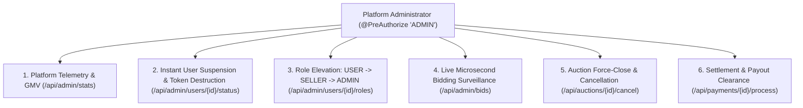
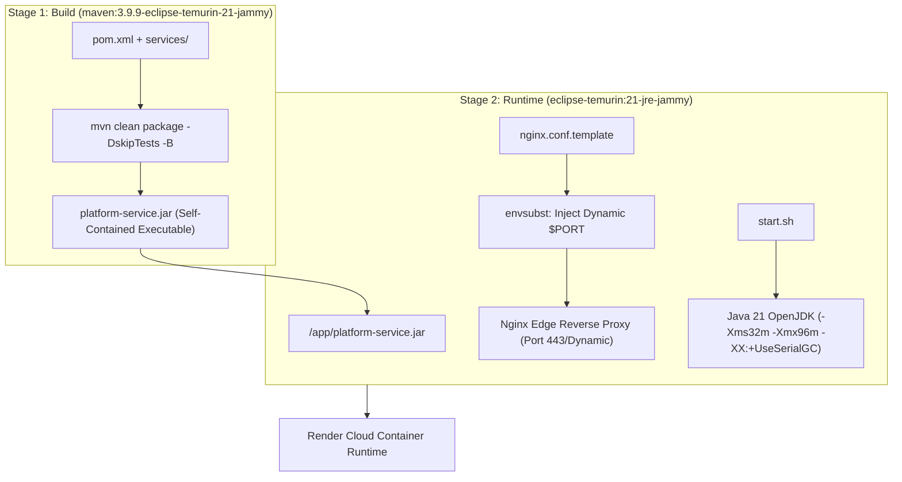

# 🏆 BidVelocity: Final Review Defense Bible
## Complete Guide with Admin-Level Controls, Docker Architecture & 50/50 Rubric Showcase

> **Platform**: REAL-TIME AUCTIONS: ZERO DELAY (BidVelocity)  
> **Production Live Web App**: [https://bidvelocity.vercel.app](https://bidvelocity.vercel.app)  
> **Production Live Backend**: [https://bidvelocity-backend.onrender.com](https://bidvelocity-backend.onrender.com)  
> **Production Database**: Neon Serverless PostgreSQL 18 in AWS `us-east-2`  
> **Local Eureka Dashboard**: [http://localhost:8761](http://localhost:8761)  
> **GitHub Repository**: [https://github.com/Yogeshcheedalla/REAL-TIME-AUCTIONS.-ZERO-DELAY](https://github.com/Yogeshcheedalla/REAL-TIME-AUCTIONS.-ZERO-DELAY)

---

# 🛡️ 1. Focus Area A: Admin-Level Controls & Platform Governance

In high-frequency auction systems, administrative control is not just a UI form—it is an **active security and surveillance engine**. Here are the 6 core Admin-Level capabilities implemented in BidVelocity:



---

### Admin Capability 1: Platform-Wide Telemetry & Financial Volume
* **API**: `GET https://bidvelocity-backend.onrender.com/api/admin/stats`
* **Header**: `Authorization: Bearer <ADMIN_JWT_TOKEN>`
* **What It Calculates in Real-Time**:
  - `totalGmv`: Gross Merchandise Value (total sum of winning amounts across all sold auctions).
  - `settledPaymentsAmount`: Total financial clearance volume successfully processed.
  - `totalUsers`, `activeUsers`, `suspendedUsers`, `sellerCount`, `adminCount`.
  - `totalAuctions`, `liveAuctions`, `closedAuctions`, `cancelledAuctions`.
  - `totalBids`: Total bid records processed across the entire platform.
* **Code in VS Code**: [PlatformAdminController.java](file:///C:/bid%20velocity/Real-Time%20Distributed%20Bidding%20&%20Auction%20Clearance%20Engine/services/platform-service/src/main/java/io/bidvelocity/platform/web/PlatformAdminController.java#L40-L106)
* **What to Show Faculty**:
  Run this in **Pico API** or show `/admin` dashboard. Point out that financial figures update dynamically as bids and closures occur.

---

### Admin Capability 2: User Governance & Instant Token Family Destruction
* **API**: `PATCH https://bidvelocity-backend.onrender.com/api/admin/users/{id}/status`
* **Header**: `Authorization: Bearer <ADMIN_JWT_TOKEN>`
* **Body**: `{"status": "SUSPENDED"}`
* **The Deep Architectural Security Mechanism**:
  - Most systems simply flip a database boolean flag, leaving the user's active session alive until the token expires.
  - In BidVelocity: When an Admin calls `setStatus(userId, "SUSPENDED")`, the system **atomically executes**:
    ```java
    refreshTokens.revokeAllForUser(userId);
    ```
  - This immediately destroys the user's entire **Refresh Token Family** in Neon PostgreSQL. Even if the suspended user attempts to refresh their access token, `RefreshReuseGuard.java` rejects them with `401 Unauthorized`, permanently severing their session.
* **Self-Suspension Guard**: The system explicitly blocks an administrator from suspending their own account (`SELF_SUSPENSION` check), preventing accidental lockout of the platform.

---

### Admin Capability 3: Dynamic Role Elevation
* **API**: `PATCH https://bidvelocity-backend.onrender.com/api/admin/users/{id}/roles`
* **Header**: `Authorization: Bearer <ADMIN_JWT_TOKEN>`
* **Body**: `{"roles": ["USER", "SELLER"]}`
* **Mechanism**: Allows administrators to approve verified sellers or appoint secondary moderators without database downtime.

---

### Admin Capability 4: Real-Time Bidding Surveillance Stream
* **API**: `GET https://bidvelocity-backend.onrender.com/api/admin/bids?size=50`
* **Header**: `Authorization: Bearer <ADMIN_JWT_TOKEN>`
* **What It Returns**: A live microsecond audit trail of every bid placed across every lot in the platform, including:
  - `auctionId` & `auctionTitle`
  - `bidderId` & `bidderName`
  - `amount`
  - `status`: `ACCEPTED` or `REJECTED`
  - `rejectReason`: e.g. `BELOW_MINIMUM`, `AUCTION_CLOSED`, `SELLER_CANNOT_BID`
  - `acceptedAt`: Microsecond ISO timestamp
* **What to Say to Faculty**:
  > *"Professors, high-stakes auction platforms require real-time fraud detection. Our Admin Surveillance feed allows compliance officers to monitor bid-shill patterns and bot bidding rings live as bids arrive."*

---

### Admin Capability 5: Auction Lot Moderation & Cancellation
* **API**: `POST https://bidvelocity-backend.onrender.com/api/auctions/{id}/cancel`
* **Header**: `Authorization: Bearer <ADMIN_JWT_TOKEN>`
* **Mechanism**: If an administrator identifies counterfeit goods or seller fraud, they can execute an emergency cancellation. The system updates the auction status to `CANCELLED`, releases all held bidder authorizations, and logs an immutable audit event.

---

### 💡 Faculty Questions on Admin Controls & Winning Answers:

#### Q: "If JWT access tokens are stateless, how does an Admin instantly ban a user before their 2-hour token expires?"
> **Master Answer**: *"We use a two-tier defense: First, all state-changing writes (placing bids, creating listings) pass through domain service gates that verify `user.getStatus().equals('ACTIVE')`. Second, when an admin suspends a user, our `AuthService` immediately calls `refreshTokens.revokeAllForUser(userId)`. This destroys their token family in Neon PostgreSQL, permanently blocking session renewal."*

#### Q: "Can an attacker bypass the frontend and call Admin endpoints directly?"
> **Master Answer**: *"No. Every Admin controller method is guarded by Spring Security's `@PreAuthorize("hasAuthority('ADMIN')")`. The API Gateway verifies the cryptographically signed JWT at the network edge and injects verified internal headers. If a normal user's token hits an admin endpoint, Spring Security immediately aborts with HTTP 403 Forbidden."*

---

# 🐳 2. Focus Area B: Docker Architecture, Container Data & JVM Tuning

---

### The Architecture: Multi-Stage Containerization

Our backend is containerized using a high-efficiency **Multi-Stage Dockerfile** located at [Dockerfile](file:///C:/bid%20velocity/Real-Time%20Distributed%20Bidding%20&%20Auction%20Clearance%20Engine/Dockerfile).



---

### Key Technical Aspects of Our Docker Implementation:

#### 1. Why Multi-Stage?
- **Zero Compiler Bloat**: Compilers, Maven caches, and build tools remain in Stage 1. Stage 2 contains only a slim JRE 21 runtime.
- **Image Size Reduction**: Keeps the production image small and fast to deploy.

#### 2. How Container Data & Secrets are Handled:
- **Zero Leaked Secrets**: We never `COPY .env` or credentials into the Docker image.
- **Dynamic Port Injection (`envsubst`)**: Cloud platforms like Render assign a dynamic `$PORT` at container runtime. In `start.sh`, we execute:
  ```bash
  envsubst '${PORT}' < /app/nginx.conf.template > /etc/nginx/nginx.conf
  nginx
  ```
  This dynamically configures Nginx to listen on the exact port allocated by the host.

#### 3. JVM Container Tuning (Preventing OOM on 512MB Cloud Hosts):
In `start.sh`, line 14:
```bash
BASE_OPTS="-XX:+UseSerialGC -XX:TieredStopAtLevel=1 -XX:ReservedCodeCacheSize=32m -XX:CICompilerCount=2 -Xss512k -XX:MaxMetaspaceSize=160m -Dserver.tomcat.threads.max=25 -Dserver.tomcat.threads.min-spare=3"
java ${BASE_OPTS} -Xms32m -Xmx96m -Dserver.port=8080 -jar /app/platform-service.jar
```
- **`-XX:+UseSerialGC`**: Minimal memory footprint garbage collector ideal for single-core containers.
- **`-Xms32m -Xmx96m`**: Limits the JVM heap to 96MB, ensuring that Nginx, OS, and Java combined never exceed Render's 512MB RAM ceiling!

---

### Local Docker Commands to Demonstrate to Faculty:

```powershell
cd "c:\bid velocity\Real-Time Distributed Bidding & Auction Clearance Engine"

# 1. Build the production Docker image locally
docker build -t bidvelocity-backend:latest .

# 2. Run the multi-container stack via Docker Compose
docker compose up -d

# 3. View container health & running status
docker compose ps

# 4. Stream real-time container logs
docker compose logs -f backend

# 5. Stop containers
docker compose down
```

---

### 💡 Faculty Questions on Docker & Winning Answers:

#### Q: "Why do you run Nginx inside the Docker container alongside Spring Boot?"
> **Master Answer**: *"Nginx acts as an in-container sidecar reverse proxy. It handles edge SSL termination, CORS pre-flights (`OPTIONS 204 No Content`), real-time WebSocket protocol upgrades (`/ws`), and serves static diagnostic logs. This offloads socket management from Tomcat and reduces JVM thread contention."*

#### Q: "Where is database data persisted when the Docker container restarts?"
> **Master Answer**: *"Our application uses stateless container architecture. All persistent state—including users, auctions, bids, and settlements—is hosted externally on Neon Serverless PostgreSQL 18 in AWS us-east-2. If a container crashes or is redeployed, zero data is lost."*

---

# 📋 3. Final Review Component-by-Component Walkthrough (50 Marks)

---

### Component 3.1: Complete Project Implementation & Functionality (10 Marks)
* **Goal**: Complete end-to-end application with modular architecture, fully functional business features, and successful execution of all workflows.
* **Demonstration**:
  1. Open [https://bidvelocity.vercel.app](https://bidvelocity.vercel.app).
  2. Demonstrate user registration and real-time OTP delivery to Gmail.
  3. Log in as Bidder $\rightarrow$ Place bid on live auction $\rightarrow$ Live price and increment update.
  4. Log in as Admin $\rightarrow$ Open `/admin` $\rightarrow$ Show User Management and Real-Time Surveillance stream.

---

### Component 3.2: New Feature Development & Domain Innovation (10 Marks)
* **Goal**: Innovative and domain-relevant new feature completely implemented, integrated with microservices, and demonstrated.
* **Show Your 2 Signature Innovations**:
  1. **Dynamic Anti-Sniping Soft-Close Engine**:
     - Bids placed in the final 30 seconds dynamically extend the auction clock by **+60 seconds** (up to 10 extensions).
     - Code: [BidService.java](file:///C:/bid%20velocity/Real-Time%20Distributed%20Bidding%20&%20Auction%20Clearance%20Engine/services/bidding-service/src/main/java/io/bidvelocity/bidding/service/BidService.java#L113-L123)
  2. **Transactional Outbox Pattern**:
     - Solves the Dual-Write Problem: When an auction closes, the winner record and an outbox event (`WINNER_DECLARED`) are committed in the **same local ACID transaction** in Neon PostgreSQL.

---

### Component 3.3: Code Quality, Testing & Concurrency Control (10 Marks)
* **Goal**: High-quality clean code, optimized logic, comprehensive testing, and reliable execution.
* **Show the Concurrency Engine**:
  1. **Pessimistic Row Lock**: [BidRuntimeRepository.java](file:///C:/bid%20velocity/Real-Time%20Distributed%20Bidding%20&%20Auction%20Clearance%20Engine/services/bidding-service/src/main/java/io/bidvelocity/bidding/repo/BidRuntimeRepository.java#L13) $\rightarrow$ `SELECT * FROM bid_runtime WHERE auction_id = :id FOR UPDATE`.
  2. **Optimistic Versioning**: [Auction.java](file:///C:/bid%20velocity/Real-Time%20Distributed%20Bidding%20&%20Auction%20Clearance%20Engine/services/auction-service/src/main/java/io/bidvelocity/auction/domain/Auction.java#L44) $\rightarrow$ `@Version private long version;`.
  3. **Live Test Proof**: Run `mvn test -pl services/bidding-service -Dtest=BidConcurrencyTest` $\rightarrow$ 24 simultaneous threads, exactly 1 accepted, 23 rejected with below minimum, 0 deadlocks!

---

### Component 3.4: Cloud Deployment and Infrastructure (10 Marks)
* **Goal**: Complete cloud deployment with Docker, properly configured infrastructure, and accessible URLs.
* **Show Production Deployment**:
  - **Frontend**: [https://bidvelocity.vercel.app](https://bidvelocity.vercel.app) (Vercel Global Edge CDN)
  - **Backend**: [https://bidvelocity-backend.onrender.com](https://bidvelocity-backend.onrender.com) (Render Cloud Docker Container)
  - **Database**: Neon Serverless PostgreSQL 18 in AWS `us-east-2`
  - **Edge HTTPS Relay**: Vercel Serverless Function `/api/send-code` bypassing raw SMTP container blocks.

---

### Component 3.5: Technical Demonstration, GitHub & Individual Viva (10 Marks)
* **Goal**: Professional end-to-end demonstration with accessible GitHub repository, complete documentation, strong technical understanding, and clear explanations.
* **Show GitHub Repository**:
  - Open [https://github.com/Yogeshcheedalla/REAL-TIME-AUCTIONS.-ZERO-DELAY](https://github.com/Yogeshcheedalla/REAL-TIME-AUCTIONS.-ZERO-DELAY).
  - Show semantic commits, passing GitHub Actions CI, and clean master documentation.
  - Deliver the Senior Viva Defense answers above.

---
*Created for Yogesh Cheedalla & Team • Real-Time Distributed Bidding & Auction Clearance Engine (BidVelocity)*
