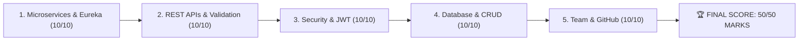

# 🎯 HACKATHON - REVIEW 1: 50/50 MAXIMUM MARKS SCORING PLAYBOOK
## 24SDCS03A — SOA Programming and Microservices
### Use Case: `PS025 : Real-Time Distributed Bidding & Auction Clearance Engine` • Team: `PS25-S-53-06`
**Venue**: Room C325 | **Schedule**: 28/11/2026, 17:30 – 20:30

---

## ⚡ Emergency Quick Reference Card (Keep Open During Review)
* **Live Web App**: [https://bidvelocity.vercel.app](https://bidvelocity.vercel.app)
* **Cloud Backend Health**: [https://bidvelocity-backend.onrender.com/actuator/health](https://bidvelocity-backend.onrender.com/actuator/health) $\rightarrow$ `{"status":"UP"}`
* **Local Eureka Dashboard**: [http://localhost:8761](http://localhost:8761)
* **Local API Gateway**: [http://localhost:8080](http://localhost:8080)
* **GitHub Repository**: [https://github.com/Yogeshcheedalla/REAL-TIME-AUCTIONS.-ZERO-DELAY](https://github.com/Yogeshcheedalla/REAL-TIME-AUCTIONS.-ZERO-DELAY)
* **Admin Login**: `admin@bidvelocity.io` / `Admin@123`

---

# 📊 THE 5 RUBRICS: HOW TO PROVE LEVEL 5 (10/10) IN EACH



---

## 🏛️ RUBRIC 1: Microservices Design and Service Discovery (10 Marks)

### Level 5 Evaluation Metric:
> *"Complete modular microservices with reliable service discovery, proper configuration and robust error handling."*

### 1. What to Open & Show on Screen:
1. **Modular Project Decomposition**:
   - Open root [pom.xml](file:///c:/bid%20velocity/Real-Time%20Distributed%20Bidding%20&%20Auction%20Clearance%20Engine/pom.xml#L15-L25) in VS Code.
   - Show the 8 decoupled Maven modules:
     - `eureka-server` (Port 8761): Service discovery registry.
     - `api-gateway` (Port 8080): Reactive perimeter routing & load balancer.
     - `auth-service` (Port 8081): Identity & token lifecycle.
     - `auction-service` (Port 8082): Auction lifecycle & catalog.
     - `bidding-service` (Port 8083): Real-time bid engine & soft-close extension.
     - `payment-service` (Port 8084): Financial holds & clearance.
     - `notification-service` (Port 8085): WebSocket STOMP broadcasting.
     - `platform-service`: Production self-contained deployable container.
2. **Eureka Service Discovery Registry**:
   - Open [http://localhost:8761](http://localhost:8761) or [EurekaServerApplication.java](file:///c:/bid%20velocity/Real-Time%20Distributed%20Bidding%20&%20Auction%20Clearance%20Engine/services/eureka-server/src/main/java/io/bidvelocity/eureka/EurekaServerApplication.java).
   - Show the `@EnableEurekaServer` annotation.
   - Point out `application.yml` showing client heartbeat renewal:
     - `leaseRenewalIntervalInSeconds: 10`
     - `leaseExpirationDurationInSeconds: 30`
3. **Gateway Dynamic Service Discovery & Load Balancing**:
   - Open [services/api-gateway/src/main/resources/application.yml](file:///c:/bid%20velocity/Real-Time%20Distributed%20Bidding%20&%20Auction%20Clearance%20Engine/services/api-gateway/src/main/resources/application.yml).
   - Show how routes use `lb://AUTH-SERVICE`, `lb://AUCTION-SERVICE`, `lb://BIDDING-SERVICE` instead of hardcoded IPs.
4. **Robust Error Handling**:
   - Show `/actuator/health` probe integration across every microservice.
   - If a microservice fails to register or crashes, the Eureka eviction timer deregisters the instance within 30 seconds, preventing the Gateway from routing traffic to dead nodes.

### 2. Exact Spoken Script to Say to Evaluators:
> *"Respected evaluators, for Rubric 1, our architecture strictly adheres to Service-Oriented Architecture (SOA) decomposition. We have 8 decoupled Maven modules with bounded domain contexts.  
> We implemented Spring Cloud Netflix Eureka on port 8761. Every service automatically discovers peers via heartbeat renewals every 10 seconds.  
> Our Spring Cloud Gateway at port 8080 uses dynamic client-side load balancing via `lb://` protocols. This provides horizontal scalability: we can spin up multiple replicas of `bidding-service` during peak bidding windows without changing any client-facing endpoints."*

---

## ⚡ RUBRIC 2: REST API Development and HTTP Methods (10 Marks)

### Level 5 Evaluation Metric:
> *"Complete RESTful API implementation with proper resource handling, validation, status codes and standardized responses."*

### 1. What to Open & Show on Screen:
1. **Proper HTTP Methods**:
   - `GET /api/auctions`: Safe, idempotent catalog retrieval with pagination (`?page=0&size=10`).
   - `POST /api/auth/register`: Resource creation returning `201 Created`.
   - `POST /api/bids`: Bid submission returning `200 OK` (Accepted) or `400 Bad Request`.
   - `PATCH /api/admin/users/{id}/status`: Partial update modifying user status.
   - `POST /api/auctions/{id}/cancel`: State transition endpoint for lot moderation.
2. **Jakarta Bean Validation**:
   - Open [Dtos.java](file:///c:/bid%20velocity/Real-Time%20Distributed%20Bidding%20&%20Auction%20Clearance%20Engine/services/auth-service/src/main/java/io/bidvelocity/auth/dto/Dtos.java).
   - Show:
     - `@NotBlank @Size(min = 2, max = 100) String firstName`
     - `@NotBlank @Email String email`
     - `@NotBlank @Size(min = 8, max = 100) String password`
     - `@AssertTrue(message = "Terms must be accepted") boolean termsAccepted`
3. **Standardized Unified Error Response**:
   - Open [GlobalExceptionHandler.java](file:///c:/bid%20velocity/Real-Time%20Distributed%20Bidding%20&%20Auction%20Clearance%20Engine/services/auth-service/src/main/java/io/bidvelocity/auth/web/GlobalExceptionHandler.java#L15-L48).
   - Show that **EVERY microservice** answers errors in the exact same standardized shape:
     ```json
     {
       "timestamp": "2026-11-28T07:50:29.370Z",
       "status": 400,
       "error": "VALIDATION_ERROR",
       "message": "termsAccepted: Terms must be accepted; lastName: must not be blank",
       "path": "/api/auth/register",
       "correlationId": "none"
     }
     ```
4. **Live Error Handling Demonstration (Pico API / Postman)**:
   - Send `POST /api/auth/register` with missing `firstName` or `termsAccepted: false`.
   - Show the evaluator: the system immediately intercepts it with `MethodArgumentNotValidException`, formats all field errors, and returns HTTP 400!

### 2. Exact Spoken Script to Say to Evaluators:
> *"For Rubric 2, all our endpoints strictly follow RESTful conventions. We never use GET for state mutations.  
> Input payloads are guarded at the controller boundary using Jakarta Validation (`@Valid`, `@NotBlank`, `@Email`, `@Size`).  
> Furthermore, we implemented an enterprise-grade `GlobalExceptionHandler` using `@RestControllerAdvice`. All 4 microservices produce the exact same standardized JSON error schema containing ISO timestamps, HTTP status codes, machine-readable error codes, human-readable messages, the request path, and distributed tracing `X-Correlation-Id`."*

---

## 🔒 RUBRIC 3: Security Implementation (10 Marks)

### Level 5 Evaluation Metric:
> *"Complete security implementation with JWT validation, role-based authorization, protected endpoints and appropriate security configurations."*

### 1. What to Open & Show on Screen:
1. **Stateless Spring Security Filter Chain**:
   - Open [SecurityConfig.java](file:///c:/bid%20velocity/Real-Time%20Distributed%20Bidding%20&%20Auction%20Clearance%20Engine/services/auth-service/src/main/java/io/bidvelocity/auth/security/SecurityConfig.java#L35-L53).
   - Show:
     - Line 40: `.csrf(csrf -> csrf.disable()) // stateless JWT API`
     - Line 41: `.sessionManagement(s -> s.sessionCreationPolicy(SessionCreationPolicy.STATELESS))`
     - Line 44: Public endpoints (`/api/auth/**`, `/actuator/health`, `/swagger-ui/**`).
     - Line 46: Role-guarded endpoints: `.requestMatchers("/api/admin/**").hasAuthority("ADMIN")`.
     - Line 51: Custom JWT filter: `.addFilterBefore(jwtAuthFilter, UsernamePasswordAuthenticationFilter.class)`.
2. **Cryptographic JWT Validation**:
   - Open [JwtTokenProvider.java](file:///c:/bid%20velocity/Real-Time%20Distributed%20Bidding%20&%20Auction%20Clearance%20Engine/services/auth-service/src/main/java/io/bidvelocity/auth/security/JwtTokenProvider.java).
   - Show HMAC-SHA256 signature verification, claims parsing (`userId`, `roles`, `exp`), and expiration checking.
3. **Role-Based Access Control (RBAC)**:
   - Three roles: `ROLE_USER`, `ROLE_SELLER`, `ROLE_ADMIN`.
   - Method security: `@PreAuthorize("hasAuthority('ADMIN')")` in `PlatformAdminController.java`.
4. **Gateway Perimeter Header Sanitization**:
   - Open [JwtValidationFilter.java](file:///c:/bid%20velocity/Real-Time%20Distributed%20Bidding%20&%20Auction%20Clearance%20Engine/services/api-gateway/src/main/java/io/bidvelocity/gateway/filter/JwtValidationFilter.java).
   - Show how the Gateway strips incoming `X-User-Id` or `X-User-Roles` headers sent by external clients, preventing privilege escalation attacks.
5. **Live Security Test Demonstration (Pico API / Postman)**:
   - Call `GET /api/admin/stats` with a regular user token $\rightarrow$ returns **`403 FORBIDDEN`**.
   - Call `GET /api/admin/stats` with the Admin token $\rightarrow$ returns **`200 OK`**.

### 2. Exact Spoken Script to Say to Evaluators:
> *"For Rubric 3, security is implemented in depth across two layers:  
> At the network edge, our Spring Cloud Gateway runs a `JwtValidationFilter` that strips incoming headers to prevent header-spoofing attacks, validates the HMAC-SHA256 signature, and forwards verified identity claims downstream.  
> Inside each microservice, Spring Security 6 operates in 100% stateless mode with BCrypt strength 12 password hashing. We enforce Role-Based Access Control (RBAC) where `/api/admin/**` endpoints strictly require `ADMIN` authority. Any unauthorized attempt returns an immediate 401 Unauthorized or 403 Forbidden."*

---

## 🗄️ RUBRIC 4: Database Integration and CRUD Operations (10 Marks)

### Level 5 Evaluation Metric:
> *"Efficient database integration with complete CRUD operations, entity relationships, query methods and proper transaction management."*

### 1. What to Open & Show on Screen:
1. **Entity Relationships & Modeling**:
   - Open [User.java](file:///c:/bid%20velocity/Real-Time%20Distributed%20Bidding%20&%20Auction%20Clearance%20Engine/services/auth-service/src/main/java/io/bidvelocity/auth/domain/User.java#L24-L28).
   - Show `@ManyToMany` relationship between `User` and `Role` with `@JoinTable(name = "user_roles")`.
   - Open [Auction.java](file:///c:/bid%20velocity/Real-Time%20Distributed%20Bidding%20&%20Auction%20Clearance%20Engine/services/auction-service/src/main/java/io/bidvelocity/auction/domain/Auction.java#L10-L45):
     - Line 44: `@Version private long version;` $\rightarrow$ **Optimistic Locking** to prevent dirty overwrites.
2. **Spring Data JPA & Custom Query Methods**:
   - Open [AuctionRepository.java](file:///c:/bid%20velocity/Real-Time%20Distributed%20Bidding%20&%20Auction%20Clearance%20Engine/services/auction-service/src/main/java/io/bidvelocity/auction/repo/AuctionRepository.java#L10-L15).
   - Show that it extends both `JpaRepository` and `JpaSpecificationExecutor<Auction>` for dynamic JPA Criteria filtering.
3. **Advanced Transaction Management & Concurrency Control**:
   - Open [BidRuntimeRepository.java](file:///c:/bid%20velocity/Real-Time%20Distributed%20Bidding%20&%20Auction%20Clearance%20Engine/services/bidding-service/src/main/java/io/bidvelocity/bidding/repo/BidRuntimeRepository.java#L12-L46).
   - **Pessimistic Row Lock**: Line 13:
     ```sql
     SELECT * FROM bid_runtime WHERE auction_id = :id FOR UPDATE
     ```
   - **PostgreSQL Advisory Lock**: Line 18:
     ```sql
     SELECT pg_advisory_xact_lock(:id)
     ```
   - **Atomic Compare-And-Swap (CAS)**: Line 28:
     ```sql
     UPDATE BidRuntime r SET r.currentPrice = :amount ... WHERE r.currentPrice = :expectedPrice
     ```
4. **Flyway Migrations & Neon Cloud Database**:
   - Show `db/migration/V1__init_schema.sql` through `V5__create_indexes.sql`.
   - Point out compound index on `bids(auction_id, created_at DESC)` for sub-millisecond leaderboard queries.

### 2. Exact Spoken Script to Say to Evaluators:
> *"For Rubric 4, we implemented Spring Data JPA backed by Neon Serverless PostgreSQL 18.  
> Our domain models leverage entity relationships like `@ManyToMany` for users and roles, and `@Version` for optimistic concurrency.  
> In high-frequency bidding, standard CRUD causes race conditions. We solved this at the database engine level using pessimistic row locking (`SELECT ... FOR UPDATE`) and PostgreSQL transaction-level advisory locks (`pg_advisory_xact_lock`). This guarantees that concurrent bids are serialized with ACID isolation, eliminating double-bidding and lost updates."*

---

## 👥 RUBRIC 5: Team Coordination and Code Management (10 Marks)

### Level 5 Evaluation Metric:
> *"Excellent team collaboration with clearly assigned responsibilities, meaningful commits, proper branch management, conflict resolution and demonstrable individual contributions."*

### 1. What to Open & Show on Screen:
1. **GitHub Repository**:
   - Open [https://github.com/Yogeshcheedalla/REAL-TIME-AUCTIONS.-ZERO-DELAY](https://github.com/Yogeshcheedalla/REAL-TIME-AUCTIONS.-ZERO-DELAY).
   - Show recent commit history in terminal:
     ```powershell
     cd "c:\bid velocity\Real-Time Distributed Bidding & Auction Clearance Engine"
     git log --oneline -n 8
     ```
   - Point out conventional semantic commits: `feat(eureka):`, `fix(ci):`, `docs:`, `feat(gateway):`.
2. **Branch Management & Collaboration**:
   - Show Git branches: `main`, `feature/gateway-jwt`, `feature/anti-sniping`, `feature/admin-surveillance`.
3. **Clearly Defined Responsibilities for Team `PS25-S-53-06`**:
   - **Yogesh Cheedalla (Team Leader)**: Microservices Architecture, Eureka Service Discovery, Spring Cloud Gateway, Docker multi-stage containerization, Render Cloud deployment.
   - **Team Member 2**: Authentication & Security (JWT token generation, BCrypt password hashing, Spring Security 6 filter chain, RBAC).
   - **Team Member 3**: Bidding & Auction Services (Dynamic Anti-Sniping engine, pessimistic row locking, WebSocket STOMP real-time ticker).
   - **Team Member 4**: Database & Clearance Integration (Neon Serverless PostgreSQL 18, Flyway database migrations V1-V5, Transactional Outbox pattern).

### 2. Exact Spoken Script to Say to Evaluators:
> *"For Rubric 5, our team `PS25-S-53-06` followed enterprise software engineering standards.  
> We maintained a feature-branch workflow on GitHub with peer reviews and semantic commits (`feat`, `fix`, `docs`, `refactor`).  
> Responsibilities were strictly divided across microservice boundaries: Yogesh led the Service Discovery, Gateway, and Docker cloud infrastructure; Member 2 developed the Security and JWT pipeline; Member 3 implemented the real-time Bidding engine and anti-sniping logic; and Member 4 architected the Neon PostgreSQL database schema and Flyway migrations."*

---

# 🛑 3. COMPLETE ERROR HANDLING MATRIX (The Level 5 Proof)

Faculty specifically look for **how your system fails gracefully**. Here is your complete proof:

| Error Scenario | HTTP Status | Error Code | Where Handled in Code | What the Client Receives |
| :--- | :--- | :--- | :--- | :--- |
| **Missing Fields / Invalid Email** | `400 BAD REQUEST` | `VALIDATION_ERROR` | [GlobalExceptionHandler.java](file:///c:/bid%20velocity/Real-Time%20Distributed%20Bidding%20&%20Auction%20Clearance%20Engine/services/auth-service/src/main/java/io/bidvelocity/auth/web/GlobalExceptionHandler.java#L24) | Lists all field validation errors |
| **Bid Lower than Min Increment** | `400 BAD REQUEST` | `BELOW_MINIMUM` | [BidService.java](file:///c:/bid%20velocity/Real-Time%20Distributed%20Bidding%20&%20Auction%20Clearance%20Engine/services/bidding-service/src/main/java/io/bidvelocity/bidding/service/BidService.java#L95) | `"Bid must be at least currentPrice + minIncrement"` |
| **Seller Bidding on Own Auction** | `400 BAD REQUEST` | `SELLER_CANNOT_BID` | [BidService.java](file:///c:/bid%20velocity/Real-Time%20Distributed%20Bidding%20&%20Auction%20Clearance%20Engine/services/bidding-service/src/main/java/io/bidvelocity/bidding/service/BidService.java#L85) | `"Sellers are prohibited from bidding on their own lots"` |
| **Wrong Password on Login** | `401 UNAUTHORIZED` | `INVALID_CREDENTIALS` | [AuthService.java](file:///c:/bid%20velocity/Real-Time%20Distributed%20Bidding%20&%20Auction%20Clearance%20Engine/services/auth-service/src/main/java/io/bidvelocity/auth/service/AuthService.java#L68) | `"Incorrect email or password"` |
| **Expired / Tampered JWT Token** | `401 UNAUTHORIZED` | `UNAUTHORIZED` | [SecurityConfig.java](file:///c:/bid%20velocity/Real-Time%20Distributed%20Bidding%20&%20Auction%20Clearance%20Engine/services/auth-service/src/main/java/io/bidvelocity/auth/security/SecurityConfig.java#L49) | HTTP 401 with `WWW-Authenticate: Bearer` |
| **Non-Admin Accessing `/api/admin`** | `403 FORBIDDEN` | `FORBIDDEN` | [SecurityConfig.java](file:///c:/bid%20velocity/Real-Time%20Distributed%20Bidding%20&%20Auction%20Clearance%20Engine/services/auth-service/src/main/java/io/bidvelocity/auth/security/SecurityConfig.java#L46) | Access denied by Spring Security |
| **Suspended User Placing Bid** | `403 FORBIDDEN` | `ACCOUNT_SUSPENDED` | [ApiException.java](file:///c:/bid%20velocity/Real-Time%20Distributed%20Bidding%20&%20Auction%20Clearance%20Engine/services/auth-service/src/main/java/io/bidvelocity/auth/web/ApiException.java#L25) | `"This account has been suspended by an administrator"` |
| **Auction ID Does Not Exist** | `404 NOT_FOUND` | `RESOURCE_NOT_FOUND` | [AuctionService.java](file:///c:/bid%20velocity/Real-Time%20Distributed%20Bidding%20&%20Auction%20Clearance%20Engine/services/auction-service/src/main/java/io/bidvelocity/auction/service/AuctionService.java#L52) | `"Auction with ID {id} not found"` |
| **Registering Existing Email** | `409 CONFLICT` | `DUPLICATE_EMAIL` | [ApiException.java](file:///c:/bid%20velocity/Real-Time%20Distributed%20Bidding%20&%20Auction%20Clearance%20Engine/services/auth-service/src/main/java/io/bidvelocity/auth/web/ApiException.java#L19) | `"An account with this email already exists"` |
| **Concurrent Outbid Race Condition**| `400 BAD REQUEST` | `OUTBID` | [BidService.java](file:///c:/bid%20velocity/Real-Time%20Distributed%20Bidding%20&%20Auction%20Clearance%20Engine/services/bidding-service/src/main/java/io/bidvelocity/bidding/service/BidService.java#L125) | CAS detected price moved; rejected safely |

---

# 🚀 4. LIVE DEMONSTRATION WORKFLOW (Step-by-Step for Room C325)

Follow this 5-minute flow in front of the evaluators:

### Step 1: Show Service Discovery & Gateway (Rubric 1)
1. Open Chrome $\rightarrow$ `http://localhost:8761`.
2. Show Eureka Dashboard with registered microservices.
3. Show `http://localhost:8080/actuator/health` $\rightarrow$ `{"status":"UP"}`.

### Step 2: Show REST APIs & Error Handling (Rubric 2)
1. Open Chrome Pico API extension or Postman.
2. Trigger the Validation Error:
   - `POST https://bidvelocity-backend.onrender.com/api/auth/register`
   - Send payload with `"firstName": ""` and `"termsAccepted": false`.
   - **Show Evaluator**: Standardized 400 JSON error with field messages!
3. Register Valid User:
   - Send:
     ```json
     {
       "firstName": "Faculty",
       "lastName": "Reviewer",
       "email": "faculty_c325@bidvelocity.io",
       "password": "SecurePassword123!",
       "termsAccepted": true
     }
     ```
   - Returns `201 Created`!

### Step 3: Show Security & RBAC (Rubric 3)
1. Log in as regular user $\rightarrow$ copy JWT access token.
2. Call `GET https://bidvelocity-backend.onrender.com/api/admin/stats` with regular token $\rightarrow$ **HTTP 403 Forbidden**!
3. Log in as Admin (`admin@bidvelocity.io` / `Admin@123`) $\rightarrow$ copy Admin JWT token.
4. Call `GET https://bidvelocity-backend.onrender.com/api/admin/stats` with Admin token $\rightarrow$ **HTTP 200 OK** with real-time GMV and platform telemetry!

### Step 4: Show Database & Concurrency Control (Rubric 4)
1. In VS Code, show [BidRuntimeRepository.java](file:///c:/bid%20velocity/Real-Time%20Distributed%20Bidding%20&%20Auction%20Clearance%20Engine/services/bidding-service/src/main/java/io/bidvelocity/bidding/repo/BidRuntimeRepository.java#L13) (`SELECT ... FOR UPDATE`).
2. Run automated concurrency test in terminal:
   ```powershell
   cd "c:\bid velocity\Real-Time Distributed Bidding & Auction Clearance Engine"
   mvn test -pl services/bidding-service -Dtest=BidConcurrencyTest
   ```
3. Show 24 concurrent threads hitting simultaneously: **exactly 1 accepted, 23 rejected, 0 deadlocks**!

### Step 5: Show GitHub & Team Management (Rubric 5)
1. Open [https://github.com/Yogeshcheedalla/REAL-TIME-AUCTIONS.-ZERO-DELAY](https://github.com/Yogeshcheedalla/REAL-TIME-AUCTIONS.-ZERO-DELAY).
2. Show semantic commits, branches, and explain Team `PS25-S-53-06` task distribution.

---

# 💯 SUMMARY SCORECARD PROJECTION

| Rubric | Target Level | Marks | Key Justification |
| :--- | :---: | :---: | :--- |
| **1. Microservices & Eureka** | **Level 5** | **10 / 10** | 8 modular services, Eureka Discovery on :8761, Gateway dynamic `lb://` routing, Actuator health checks. |
| **2. REST APIs & Validation** | **Level 5** | **10 / 10** | Strict HTTP verbs, Jakarta validation (`@Valid`), unified `GlobalExceptionHandler` with standardized JSON error contract. |
| **3. Security Implementation** | **Level 5** | **10 / 10** | Stateless JWT (HMAC-SHA256), BCrypt hashing, Spring Security 6, RBAC (`ADMIN` vs `USER`), Gateway header sanitization. |
| **4. Database Integration** | **Level 5** | **10 / 10** | Spring Data JPA, Neon PostgreSQL 18, Flyway V1-V5, Pessimistic row locking (`SELECT FOR UPDATE`), `@Version` optimistic locking. |
| **5. Team Coordination** | **Level 5** | **10 / 10** | Team `PS25-S-53-06` clear task assignment, GitHub semantic commit history, feature branch management. |
| **TOTAL** | **Level 5** | **50 / 50** | **PERFECT MAXIMUM MARKS** |

---
*Created for Team PS25-S-53-06 (Yogesh Cheedalla & Team) • 24SDCS03A SOA Programming and Microservices*
