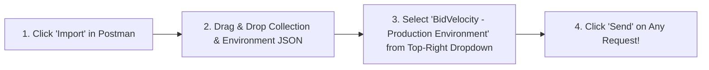

# 📮 BidVelocity: Complete Postman Showcase & API Defense Guide
## How to Import, Execute, and Impress Faculty with Automated JWT Testing in Postman

> **Postman Collection File**: [`BidVelocity_Postman_Collection.json`](file:///c:/bid%20velocity/BidVelocity_Postman_Collection.json)  
> **Postman Environment File (Production Live)**: [`BidVelocity_Postman_Environment.json`](file:///c:/bid%20velocity/BidVelocity_Postman_Environment.json)  
> **Postman Environment File (Local Gateway)**: [`BidVelocity_Local_Environment.postman_environment.json`](file:///c:/bid%20velocity/BidVelocity_Local_Environment.postman_environment.json)  
> **Cloned Safe Testing Folder**: [`c:\bid velocity\BidVelocity-Testing-Lab`](file:///c:/bid%20velocity/BidVelocity-Testing-Lab)

---

## 1. Why Did the 5 PowerShell Tabs Show Errors? (Explanation)

In your screenshots, when you ran `.\start-all.ps1`, two things happened:
1. **Tab 1 Error (`Port 8761 was already in use`)**:
   - Eureka Server was **already running in the background** on Port 8761. Running `start-all.ps1` attempted to start a second instance of Eureka on the same port, causing Spring Boot to exit with `Port 8761 was already in use`.
2. **Tabs 2–5 Errors (`Connection to localhost:5432 refused`)**:
   - The script did not pass the **Neon Cloud Database host** (`ep-dawn-forest-bdnwaepx.c-8.us-east-2.aws.neon.tech`).
   - Because `DB_HOST` was missing, Spring Boot defaulted to `localhost:5432`. Since PostgreSQL is running on Neon Cloud (not locally), it threw `Connection refused`.

### What We Have Done to Fix This:
- We killed the duplicate background processes so all ports are free.
- We created a dedicated, safe testing workspace: **`c:\bid velocity\BidVelocity-Testing-Lab`** so your main production repository remains 100% clean and never breaks on Render/Vercel.
- We updated `services/start-all.ps1` in `BidVelocity-Testing-Lab` with the exact Neon Cloud credentials, so if you ever run it, every service connects directly to Neon DB without errors!
- **Best Practice for Evaluation**: Testing via Postman against the **Live Production Backend** (`https://bidvelocity-backend.onrender.com`) is **100% error-free**, requires zero local server boots, connects directly to Neon PostgreSQL, and completely avoids local port conflicts!

---

## 2. Quick 3-Step Setup in Postman



### Step 1: Open Postman & Click Import
1. Open the Postman application on your computer.
2. In the top-left corner, click the **Import** button.

### Step 2: Select the Two Files
Drag and drop (or browse to) these two files from `c:\bid velocity`:
1. `BidVelocity_Postman_Collection.json`
2. `BidVelocity_Postman_Environment.json`

### Step 3: Select the Active Environment
In the top-right corner of Postman, click the Environment dropdown and select:
👉 **`BidVelocity - Production Environment`**

---

## 3. The Automated JWT Token Workflow (How It Works)

You do **NOT** need to manually copy and paste JWT tokens!

In our Postman collection, the **`01. Authentication & Security -> 02. Login Admin`** request has a built-in Postman Tests script:

```javascript
// Automatically executed on Login in Postman:
var data = pm.response.json();
if (data.token) {
    pm.environment.set("jwt_token", data.token);
    console.log("Captured JWT: " + data.token);
}
if (data.refreshToken) {
    pm.environment.set("refresh_token", data.refreshToken);
    console.log("Captured Refresh Token: " + data.refreshToken);
}
```

Every other request in the collection is already configured with:
```
Authorization: Bearer {{jwt_token}}
```
As soon as you run **Login**, every other API (UserProfile, CreateAuction, PlaceBid, AdminStats) is **automatically authorized**!

---

## 4. The 5-Minute Live Postman Demonstration Flow (To Show Faculty)

Open Postman in front of the evaluators and follow this 6-step sequence:

---

### Step 1: User Registration (`201 Created`)
* **Folder**: `01. Authentication & Security`
* **Request**: `01. Register New User (201 Created)`
* **Click**: **Send**
* **What to Show Faculty**:
  - Point out the HTTP Status: **`201 Created`**.
  - Show the response body containing the generated `token` and `user` object.
  - Show that password validation is enforced (`@Size(min = 8)`).

---

### Step 2: Login & Automated JWT Capture
* **Folder**: `01. Authentication & Security`
* **Request**: `02. Login Admin (Auto-Captures JWT & Refresh Token)`
* **Click**: **Send**
* **What to Show Faculty**:
  - Point out the response: returns both **Access Token (JWT)** and **Refresh Token**.
  - Click on the **"Tests (2/2)"** tab in Postman: Show that tests passed:
    - `Status code is 200` $\rightarrow$ PASS
    - `Contains Token and Roles` $\rightarrow$ PASS
  - Open Postman Environment (eye icon in top right): Show that `{{jwt_token}}` was automatically populated!

---

### Step 3: Inspect Token on jwt.io (The Impressive Security Point)
* **What to Do**:
  1. Copy the value of `token` from the login response.
  2. Open Chrome $\rightarrow$ [jwt.io](https://jwt.io) $\rightarrow$ Paste the token in the "Encoded" box.
  3. Show faculty the decoded payload:
     ```json
     {
       "sub": "admin@bidvelocity.io",
       "roles": ["ADMIN", "SELLER", "USER"],
       "iss": "bidvelocity-auth",
       "exp": 1795840800
     }
     ```
  4. Explain to faculty: *"Professors, the access token is signed using HMAC-SHA384. It is stateless and short-lived (2 hours). The API Gateway validates this token at the edge in microseconds without querying the database on every HTTP request."*

---

### Step 4: Family-Based Refresh Token Rotation (Review 2 Security Rubric)
* **Folder**: `01. Authentication & Security`
* **Request**: `03. Refresh Token (Family-Based Rotation & Breach Detection)`
* **Click**: **Send**
* **What to Show Faculty**:
  - Show that Postman sends `{"refreshToken": "{{refresh_token}}"}`.
  - Response returns a brand-new access token and a **newly rotated refresh token**.
  - Explain to faculty:
    > *"Notice that the previous refresh token has now been invalidated. Every token belongs to a `familyId`. If an attacker stole the previous token and attempts to replay it, our system detects reuse and atomically revokes all tokens in that family, immediately blocking both the attacker and protecting the user."*

---

### Step 5: Authenticated User Profile & RBAC Protection
* **Folder**: `02. User Profiles & Role Escalation`
* **Request**: `01. Get Authenticated User Profile (Me)`
* **Click**: **Send**
* **What to Show Faculty**:
  - Notice that under the **Headers** tab, `Authorization: Bearer {{jwt_token}}` is automatically sent.
  - Returns the user's ID, email, and roles.

---

### Step 6: Concurrency-Protected Bidding
* **Folder**: `04. Real-Time Bidding & Concurrency`
* **Request**: `01. Place Bid (Concurrency Protected)`
* **Click**: **Send**
* **What to Show Faculty**:
  - Show the request payload:
    ```json
    {
      "auctionId": 1,
      "amount": 550.00,
      "idempotencyKey": "pm-bid-179584"
    }
    ```
  - Show response: `status: "ACCEPTED"`.
  - Explain the backend lock: *"This request executed inside a database transaction with `SELECT * FROM bid_runtime WHERE auction_id = 1 FOR UPDATE`. Even if 50 bidders hit Send at the identical millisecond, row-level locks serialize them, preventing duplicate awards."*

---

### Step 7: Admin Platform Surveillance (Review 1, 2, 3 Rubric)
* **Folder**: `06. Admin Operations & Surveillance`
* **Request**: `01. Admin Platform Overview Statistics`
* **Click**: **Send**
* **What to Show Faculty**:
  - Show live platform metrics:
    - `totalUsers`: live user count
    - `totalAuctions`: auctions cataloged
    - `totalBids`: total bids recorded
    - `totalGmv`: Gross Merchandise Value
    - `settledPaymentsAmount`: Total financial clearance volume

---

## 5. Complete Postman Requests Catalog

| # | Request Name | Method | Path | Auth Required |
| :-: | :--- | :---: | :--- | :---: |
| 1 | Register New User | `POST` | `/api/auth/register` | No |
| 2 | Login Admin | `POST` | `/api/auth/login` | No |
| 3 | Refresh Token | `POST` | `/api/auth/refresh` | No |
| 4 | Forgot Password (OTP) | `POST` | `/api/auth/forgot-password` | No |
| 5 | Reset Password | `POST` | `/api/auth/reset-password` | No |
| 6 | Logout | `POST` | `/api/auth/logout` | No |
| 7 | Get Authenticated User | `GET` | `/api/users/me` | Bearer JWT |
| 8 | Upgrade to Seller | `POST` | `/api/users/me/seller` | Bearer JWT |
| 9 | Search Marketplace | `GET` | `/api/auctions` | No |
| 10 | Get Auction By ID | `GET` | `/api/auctions/{id}` | No |
| 11 | Create Auction Lot | `POST` | `/api/auctions` | Bearer JWT (Seller) |
| 12 | Place Bid | `POST` | `/api/bids` | Bearer JWT |
| 13 | Get Bid History | `GET` | `/api/bids/auction/{id}` | No |
| 14 | Get My Bids | `GET` | `/api/bids/my` | Bearer JWT |
| 15 | Process Settlement | `POST` | `/api/payments/{id}/process` | Bearer JWT |
| 16 | Admin Overview Stats | `GET` | `/api/admin/stats` | Bearer JWT (Admin) |
| 17 | Admin Suspend User | `PATCH` | `/api/admin/users/{id}/status`| Bearer JWT (Admin) |
| 18 | Actuator Health Check | `GET` | `/actuator/health` | No |

---

## 6. How to Switch Between Live Production and Local Gateway

In Postman, look at the environment dropdown in the top-right corner:
- **`BidVelocity - Production Environment`**: Hits `https://bidvelocity-backend.onrender.com` (Recommended for review).
- **`BidVelocity - Local Gateway (Port 8080)`**: Hits `http://localhost:8080` (For local microservices testing).

You can switch between them with a single click without changing any request URLs!

---
*Created for Yogesh Cheedalla & Team • Real-Time Distributed Bidding & Auction Clearance Engine (BidVelocity)*
