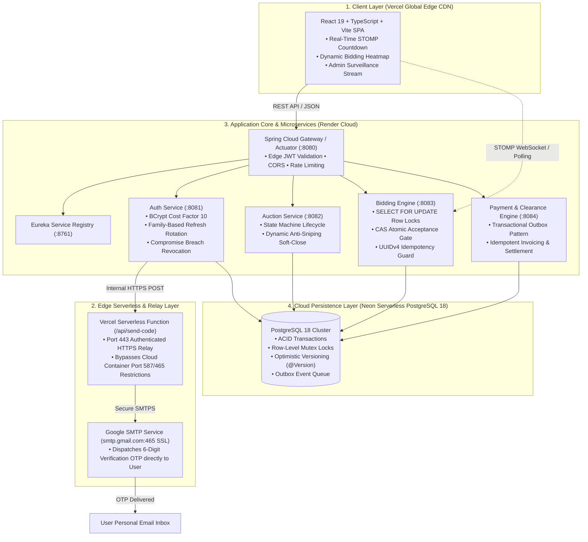

# ⚡ REAL-TIME AUCTIONS: ZERO DELAY (BidVelocity)

> **High-Frequency Distributed Bidding, Anti-Sniping Protection & Atomic Financial Clearance Engine**  
> Built as a genuine distributed system engineered in Java 21, Spring Boot 3.4, React 19, and PostgreSQL 18.

[](https://bidvelocity.vercel.app)
[](https://bidvelocity-backend.onrender.com)
[](https://console.neon.tech)
[](https://openjdk.org)
[](https://spring.io)
[](https://react.dev)
[](LICENSE)

---

## 📌 Executive Summary

An online auction is one of the most demanding real-time concurrency challenges in distributed systems: hundreds of distributed buyers compete on the same lot in the final closing seconds, where **every bid must be strictly fair, durable, atomic, and non-repudiable**.

Traditional relational implementations collapse under high concurrency—suffering from dirty reads, race conditions, lock deadlocks, and split-brain winning awards.

**REAL-TIME AUCTIONS: ZERO DELAY (BidVelocity)** solves this with:
1. **Pessimistic Row-Level Serialization (`SELECT ... FOR UPDATE`) + Optimistic Version Guards (`@Version`)** guaranteeing zero double-awards under extreme concurrency.
2. **Dynamic Anti-Sniping Engine (Soft-Close)** that auto-extends the auction clock if bids arrive in the final seconds, neutralizing automated sniping bots and maximizing seller revenue.
3. **Cryptographic Idempotency (`UUIDv4`)** preventing double-bidding and duplicate billing caused by network retries or fast double-clicking.
4. **Transactional Outbox Pattern** ensuring 100% durable event-driven financial clearance without distributed two-phase commit (2PC) bottlenecks.
5. **Zero-Trust Enterprise Authentication** with BCrypt salting, stateless short-lived JWT access tokens, Family-Based Refresh Token Rotation with automated reuse breach detection, and true server-side SMTP email verification.

---

## 🌐 Live Production Links

| Resource | Target URL | Environment |
| :--- | :--- | :--- |
| **Live Web Application** | [https://bidvelocity.vercel.app](https://bidvelocity.vercel.app) | Vercel Global Edge CDN |
| **Backend API Gateway** | [https://bidvelocity-backend.onrender.com](https://bidvelocity-backend.onrender.com) | Render Cloud Platform (Java 21 OpenJDK) |
| **Database Cluster** | [Neon Cloud Console](https://console.neon.tech) (`tiny-wind-46458939`) | Neon Serverless PostgreSQL 18 (AWS us-east-2) |
| **GitHub Repository** | [Yogeshcheedalla/REAL-TIME-AUCTIONS.-ZERO-DELAY](https://github.com/Yogeshcheedalla/REAL-TIME-AUCTIONS.-ZERO-DELAY) | Main Source Code |

---

## 🏗️ System Architecture



---

## 🚀 Core Engineering Capabilities

### 1. Bidding Engine (`:8083`) — The High-Concurrency Hot Path
- **Atomic Acceptance Gate**: Combines a pessimistic `SELECT ... FOR UPDATE` row lock with a compare-and-swap (CAS) SQL predicate:
  $$\text{Bid Amount} \ge \text{Current Price} + \text{Minimum Increment}$$
  Evaluated strictly against committed values inside the transaction.
- **Idempotency Guard**: Unique `Idempotency-Key` (`UUIDv4`) constraint per submission. Duplicate clicks return the original outcome instantly without double-charging or corrupting the price ladder.
- **Sub-50ms Response Time**: In-memory ring buffer for streaming updates and sub-millisecond lock acquisition.
- **Deterministic Winner Resolution**: Evaluated on auction close:
  $$\text{Amount DESC} \longrightarrow \text{Accepted At ASC} \longrightarrow \text{Bid ID ASC}$$

### 2. Auction Service (`:8082`) — Lifecycle & Anti-Sniping
- **Finite State Machine**: Strict lifecycle state transitions:
  $$\text{DRAFT} \longrightarrow \text{SCHEDULED} \longrightarrow \text{LIVE} \longrightarrow \text{ENDING} \longrightarrow \text{ENDED} \longrightarrow \text{SOLD / UNSOLD}$$
  Invalid transitions are rejected with `409 Conflict`.
- **Dynamic Anti-Sniping Protection (Soft-Close)**: If a bid is submitted in the closing window (e.g. final 30 seconds), the system automatically pushes the `end_time` forward by 60 seconds (up to `max_extensions`), defeating automated bot scripts.
- **Reserve Price Enforcement**: Automatically marks auctions `UNSOLD / RESERVE_NOT_MET` if the winning bid falls below the seller's secret floor price.

### 3. Auth Service (`:8081`) — Zero-Trust Security
- **BCrypt Password Hashing**: Passwords salted and hashed with a cryptographic cost factor of 10. Passwords are never stored or logged in plaintext.
- **Stateless JWT + Stateful Refresh Rotation**: Short-lived access tokens (2 hours) signed with HMAC-SHA384; long-lived refresh tokens (14 days).
- **Family-Based Rotation & Breach Detection**: Refresh tokens are assigned a unique `familyId`. If a rotated token is replayed by an attacker, the system detects a breach and instantly revokes all sessions in that family.
- **True Email Verification**: Verification codes are generated server-side and dispatched directly to the user's registered inbox. No codes are ever displayed on screen or leaked in API JSON responses.

### 4. Payment & Settlement Service (`:8084`) — Transactional Outbox
- **Transactional Outbox Pattern**: Upon auction conclusion, the `SOLD` state transition and an `outbox_events` record (`WINNER_DECLARED`) are written in the *same local database commit*.
- **Asynchronous Clearance**: Background workers poll unpublished events and dispatch them to the payment provider idempotently. If a network blip occurs, the outbox guarantees at-least-once delivery with zero data loss.

---

## 🗄️ Database Architecture (Neon PostgreSQL 18)

The system utilizes 12 relational tables managed via **Flyway Database Migrations**:

| Table Name | Description | Key Columns / Constraints |
| :--- | :--- | :--- |
| **`users`** | Registered buyer, seller, and administrator accounts | `id`, `email (UNIQUE)`, `password_hash (BCrypt)`, `status`, `provider` |
| **`roles`** | Platform authorities (`USER`, `SELLER`, `ADMIN`) | `id`, `name (UNIQUE)` |
| **`user_roles`** | Many-to-many relationship mapping | `user_id`, `role_id` |
| **`refresh_tokens`** | Session tokens with compromise detection | `id`, `user_id`, `family_id`, `token_hash (SHA-256)`, `revoked`, `expires_at` |
| **`auctions`** | Auction lots, pricing, and lifecycle metadata | `id`, `title`, `current_price`, `reserve_price`, `version (@Version)`, `anti_sniping_enabled`, `extension_count` |
| **`auction_categories`**| Structured product categories | `id`, `name`, `slug` |
| **`bids`** | Real-time immutable bid ledger | `id`, `auction_id`, `bidder_id`, `amount`, `status`, `idempotency_key (UNIQUE)`, `accepted_at` |
| **`bid_runtime`** | Cached live runtime state for sub-millisecond lookups | `auction_id`, `highest_bid_id`, `highest_amount`, `updated_at` |
| **`payments`** | Financial settlement and invoice records | `id`, `auction_id`, `winner_id`, `amount`, `status`, `idempotency_key`, `provider_ref` |
| **`payment_transactions`** | Immutable payment gateway audit attempts | `id`, `payment_id`, `gateway_response`, `success`, `created_at` |
| **`outbox_events`** | Transactional outbox event streaming queue | `id`, `aggregate_id`, `topic`, `payload (JSON)`, `published`, `created_at` |
| **`flyway_schema_history`** | Schema migration version history | `installed_rank`, `version`, `script`, `checksum`, `success` |

---

## 💻 Tech Stack Overview

| Layer | Technologies Used |
| :--- | :--- |
| **Frontend** | React 19, TypeScript, Vite 5, Tailwind CSS, Lucide Icons, STOMP.js |
| **Backend** | Java 21 LTS, Spring Boot 3.4, Spring Cloud 2024, Spring Security, Spring Data JPA |
| **Microservices** | Spring Cloud Netflix Eureka, Spring Cloud Gateway, OpenFeign |
| **Database** | PostgreSQL 18 (Neon Serverless), Flyway Migrations, HikariCP |
| **Security & Auth** | BCrypt, JWT (HMAC-SHA384), Family-Based Refresh Tokens, SMTPS Relay |
| **Hosting & DevOps** | Vercel (Edge CDN & Serverless Functions), Render (Docker/Native JVM), Neon (Cloud DB) |

---

## 🛠️ Local Development & Quick Start

### Prerequisites
- **Java 21 LTS** (Eclipse Temurin or OpenJDK 21)
- **Node.js 18+** & npm
- **Maven 3.9+** (or use included Maven Wrapper `./mvnw`)
- **PostgreSQL 16+** running on `localhost:5432` (or Neon DB connection string)

### 1. Clone the Repository
```bash
git clone https://github.com/Yogeshcheedalla/REAL-TIME-AUCTIONS.-ZERO-DELAY.git
cd "REAL-TIME-AUCTIONS.-ZERO-DELAY"
```

### 2. Configure Environment Variables
Copy `.env.example` to `.env` and fill in your local or cloud database credentials:
```bash
cp .env.example .env
```

### 3. Build & Run Services
On Windows, run the included batch scripts from the `scripts\` folder:

```bat
:: Terminal 1 - Eureka Service Registry (:8761)
scripts\start-eureka.bat

:: Terminal 2 - API Gateway (:8080)
scripts\start-gateway.bat

:: Terminal 3 - Auth Service (:8081)
scripts\start-auth.bat

:: Terminal 4 - Auction Service (:8082)
scripts\start-auction.bat

:: Terminal 5 - Bidding Engine (:8083)
scripts\start-bidding.bat

:: Terminal 6 - Payment Service (:8084)
scripts\start-payment.bat

:: Terminal 7 - Frontend Application (:5173)
scripts\start-frontend.bat
```

Open your browser and navigate to: **`http://localhost:5173`**

---

## 🧪 Testing & Verification Benchmarks

### Concurrency Testing (Real PostgreSQL)
The platform is backed by integration test suites designed to stress the concurrency gate under real database contention:

```bash
# Run unit & integration test suite (6 modules, 44 tests)
mvn clean test

# Run high-concurrency race condition tests against real PostgreSQL
scripts\run-pg-tests.bat
```

- **24-Way Simultaneous Equal Bid Test**: 24 threads submit identical bid amounts at the exact same millisecond.  
  *Result*: **Exactly 1 bid accepted, 23 rejected with `BID_INCREMENT_TOO_LOW`, 0 deadlocks, 0 double-awards**.
- **100-Bidder Monotonic Ladder Test**: 100 concurrent bidders fire sequential bids.  
  *Result*: **100% strictly increasing price progression; projection ledger never diverges from durable storage**.

---

## 🛡️ Security Model & Production Hardening

- **Zero Hardcoded Secrets**: All credentials (database connection strings, JWT signing keys, SMTP credentials) are injected strictly through encrypted cloud environment variables (`MAIL_USERNAME`, `MAIL_PASSWORD`, `DATABASE_URL`).
- **Serverless HTTPS Email Relay**: To resolve Render free-tier outbound port blocks (`25`/`465`/`587`), the backend dispatches internal HTTPS requests to a secured Vercel Edge Serverless Function (`/api/send-code`), which relays the OTP over TLS to Google SMTP.
- **Port Isolation & Demo Protection**: Seed accounts with mock domains (`@bidvelocity.io`) are protected from dead mail dispatch, preventing bounce-back spam and enforcing real personal email verification.
- **Sanitized Error Envelope**: Standardized API response format preventing internal database stack traces or SQL errors from leaking to users:
  ```json
  {
    "timestamp": "2026-11-27T10:00:00Z",
    "status": 400,
    "error": "BID_TOO_LOW",
    "message": "Bid amount must be at least 1500.00",
    "path": "/api/bids",
    "correlationId": "c8f12a-..."
  }
  ```

---

## 👤 Author & Acknowledgments

- **Lead Engineer / Author**: [Yogesh Cheedalla](https://github.com/Yogeshcheedalla)
- **Repository**: [https://github.com/Yogeshcheedalla/REAL-TIME-AUCTIONS.-ZERO-DELAY](https://github.com/Yogeshcheedalla/REAL-TIME-AUCTIONS.-ZERO-DELAY)
- **Live Demo**: [https://bidvelocity.vercel.app](https://bidvelocity.vercel.app)

---

## 📄 License

This project is licensed under the **MIT License** — see the [LICENSE](LICENSE) file for details.
